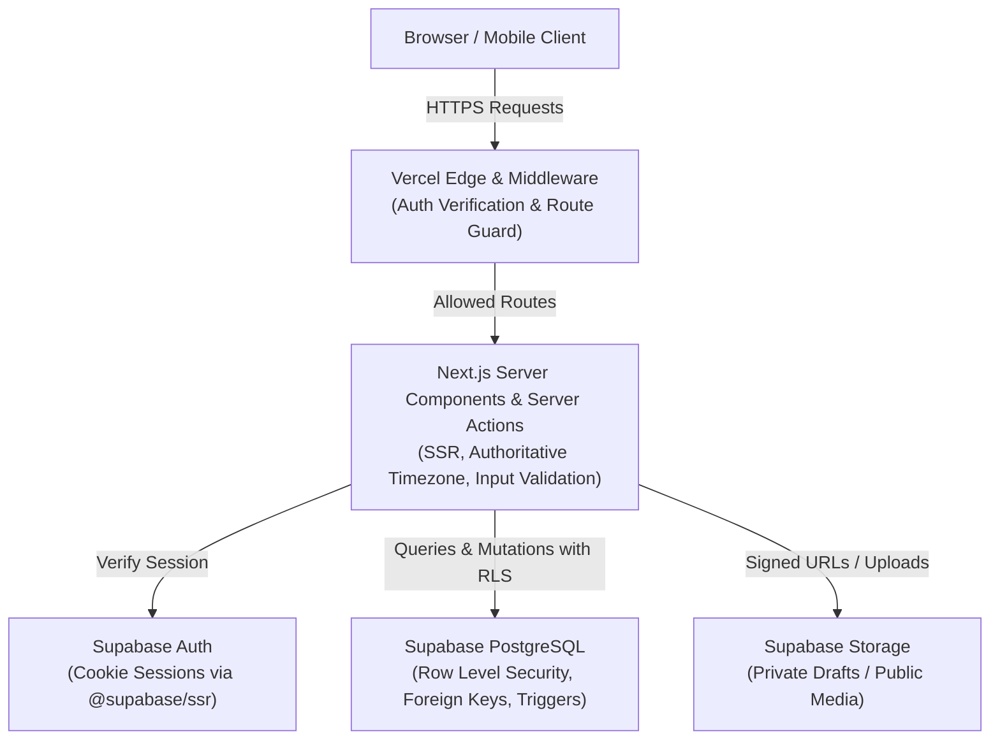
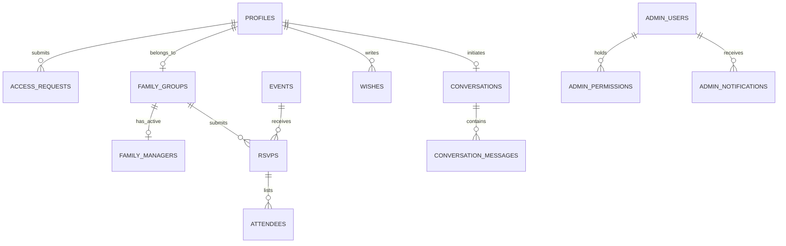
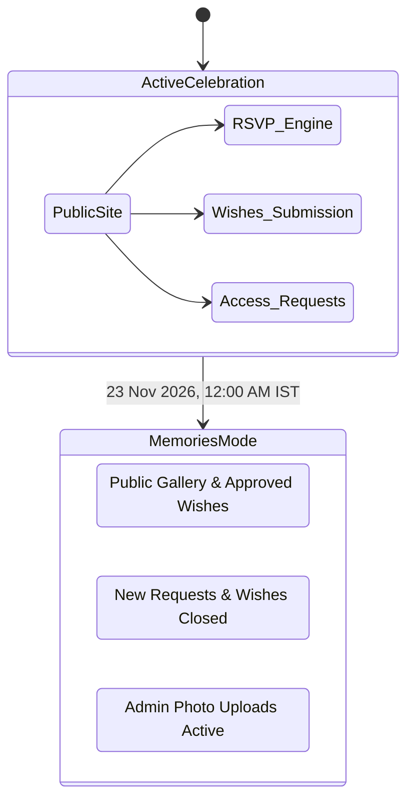

# Mithun & Kabita Wedding Website — Architecture & Security Specification

**Document ID:** `docs/ARCHITECTURE_AND_SECURITY.md`  
**Version:** 1.1.0  
**Status:** Implemented Database Foundation (Phase P-07)  
**Current Phase:** P-07 — Supabase Database, Versioned Migrations and Security Foundation Complete  
**Primary Database & Auth Platform:** Supabase (PostgreSQL, Supabase Auth, Supabase Storage, Row Level Security)  
**Hosting Infrastructure:** Vercel (Hobby Tier)  
**Timezone Standard:** `Asia/Kolkata` (IST / UTC+05:30)  

---

## 1. Technical Architecture Overview

The system is architected as a high-performance, server-first modern web application built on **Next.js App Router**, **React**, **TypeScript**, and **Tailwind CSS**, with **Supabase PostgreSQL** as the single source of truth for all transactional, relational, and authentication data.



### Architectural Principles
1. **Server-First Data Access:** Data fetching executes predominantly in React Server Components (RSC) to maximize SEO, minimize client bundle sizes, and eliminate waterfall API calls.
2. **Zero Trust in Client Time:** All time-sensitive operations (RSVP deadlines, date-specific countdown messages, Memories Mode transitions) evaluate against the authoritative server clock converted to `Asia/Kolkata`.
3. **Defense-in-Depth:** Application-level validation in Next.js Server Actions is backed by rigorous PostgreSQL constraints, triggers, and Row Level Security (RLS) policies.
4. **Zero Paid Third-Party APIs:** Every capability operates reliably within free-tier infrastructure (Vercel Hobby, Supabase Free).

---

## 2. Directory Structure Specification

The proposed workspace directory layout enforces clear separation of concerns:

```text
mithun-kabita-wedding/
├── .agents/                      # Workspace skills & instructions (preserved)
├── docs/                         # Authoritative planning documents
│   ├── PROJECT_BRIEF.md
│   ├── PHASE_ROADMAP.md
│   ├── DESIGN_BIBLE.md
│   ├── ARCHITECTURE_AND_SECURITY.md
│   ├── CONTENT_AND_EVENT_DATA.md
│   └── ACCEPTANCE_CRITERIA.md
├── public/                       # Static public assets (SVGs, favicon, manifests)
│   ├── fonts/
│   ├── ornaments/
│   └── icons/
├── src/
│   ├── app/                      # Next.js App Router root
│   │   ├── (auth)/               # Login, register, forgot-password routes
│   │   ├── (guest)/              # Protected guest routes (/dashboard, /dashboard/rsvp)
│   │   ├── (public)/             # Public pages (/, /events, /gallery, /invitation, /privacy, /terms)
│   │   ├── admin/                # Protected admin console (/admin/*)
│   │   ├── api/                  # Minimal webhooks & audio/calendar streaming endpoints
│   │   ├── globals.css           # Tailwind directives & CSS variables
│   │   └── layout.tsx            # Global Root Layout (Fonts, Audio Provider, Providers)
│   ├── components/               # UI Component Hierarchy
│   │   ├── ui/                   # Atomic primitives (Button, Input, Modal, Badge, Heading)
│   │   ├── ornaments/            # SVG royal Indian ornaments (Arch, Divider, Mandala)
│   │   ├── navigation/           # Luxury navigation bar, mobile drawer, footer
│   │   ├── sections/             # Homepage narrative sections
│   │   ├── invitation/           # Digital Invitation Studio (Designs A & B, PDF/PNG renderers)
│   │   ├── rsvp/                 # Ceremony-specific RSVP cards, attendee manager
│   │   ├── gallery/              # Photo grid, lightbox, video player
│   │   ├── audio/                # Persistent background music player
│   │   └── admin/                # Admin tables, moderation panels, notification center
│   ├── actions/                  # Typed Server Actions (Mutations & Secure API Logic)
│   │   ├── access-requests.ts
│   │   ├── rsvp.ts
│   │   ├── wishes.ts
│   │   ├── conversations.ts
│   │   ├── media.ts
│   │   └── admin-management.ts
│   ├── lib/                      # Core application utilities
│   │   ├── supabase/             # Supabase clients (client, server, middleware, admin)
│   │   ├── timezone.ts           # Authoritative Asia/Kolkata date & deadline utilities
│   │   ├── lifecycle.ts          # Memories Mode state machine
│   │   ├── calendar.ts           # Standards-compliant .ics & Google Calendar generators
│   │   └── utils.ts              # Class merging (cn) & formatting
│   ├── styles/                   # Custom CSS tokens
│   │   └── tokens.css
│   └── types/                    # Shared TypeScript definitions
│       ├── database.types.ts     # Auto-generated Supabase schema definitions
│       └── wedding.types.ts      # Domain models & view types
├── supabase/
│   └── migrations/               # Immutable SQL migration files
├── .env.example                  # Sanitized environment template
├── package.json
├── tailwind.config.ts
└── tsconfig.json
```

---

## 3. Relational Database Schema Design

The PostgreSQL database comprises **14 core relational entities**. All timestamps use `TIMESTAMP WITH TIME ZONE` and evaluate against `Asia/Kolkata`.



### Table Specifications

#### 1. `profiles`
Represents every registered user (public guest, manager, or admin).
* `id` (`UUID`, PK, references `auth.users.id` ON DELETE CASCADE)
* `full_name` (`TEXT`, NOT NULL)
* `email` (`TEXT`, NOT NULL, UNIQUE)
* `mobile_number` (`TEXT`, NULL)
* `avatar_url` (`TEXT`, NULL)
* `is_approved_guest` (`BOOLEAN`, NOT NULL, DEFAULT FALSE)
* `family_group_id` (`UUID`, NULL, references `family_groups.id` ON DELETE SET NULL)
* `created_at` (`TIMESTAMPTZ`, NOT NULL, DEFAULT NOW())
* `updated_at` (`TIMESTAMPTZ`, NOT NULL, DEFAULT NOW())
*(Note: Administrative privileges and `is_super_admin` are strictly isolated in `admin_users` to prevent self-elevation).*

#### 2. `family_groups`
Represents an invited family or party unit.
* `id` (`UUID`, PK, DEFAULT gen_random_uuid())
* `name` (`TEXT`, NOT NULL) — e.g., "The Mukherjee Family"
* `notes` (`TEXT`, NULL)
* `created_by` (`UUID`, NOT NULL, references `profiles.id`)
* `created_at` (`TIMESTAMPTZ`, NOT NULL, DEFAULT NOW())

#### 3. `family_managers`
Controls the single active RSVP manager for each family group.
* `id` (`UUID`, PK, DEFAULT gen_random_uuid())
* `family_group_id` (`UUID`, NOT NULL, references `family_groups.id` ON DELETE CASCADE)
* `profile_id` (`UUID`, NOT NULL, references `profiles.id` ON DELETE CASCADE)
* `is_active` (`BOOLEAN`, NOT NULL, DEFAULT TRUE)
* `assigned_at` (`TIMESTAMPTZ`, NOT NULL, DEFAULT NOW())
* `assigned_by` (`UUID`, NOT NULL, references `profiles.id`)
* `revoked_at` (`TIMESTAMPTZ`, NULL)
* **Constraint:** Partial unique index: `CREATE UNIQUE INDEX idx_single_active_family_manager ON family_managers (family_group_id) WHERE is_active = TRUE;` (Guarantees at most one active manager per family).

#### 4. `access_requests`
Submissions from unapproved registered guests requesting wedding RSVP access.
* `id` (`UUID`, PK, DEFAULT gen_random_uuid())
* `profile_id` (`UUID`, NOT NULL, references `profiles.id` ON DELETE CASCADE)
* `invited_family_name` (`TEXT`, NOT NULL)
* `relationship_to_couple` (`TEXT`, NOT NULL)
* `message` (`TEXT`, NULL)
* `status` (`TEXT`, NOT NULL, DEFAULT 'pending') — CHECK (`status IN ('pending', 'approved', 'rejected')`)
* `rejection_reason` (`TEXT`, NULL) — NOT NULL when `status = 'rejected'`
* `reviewed_by` (`UUID`, NULL, references `profiles.id`)
* `reviewed_at` (`TIMESTAMPTZ`, NULL)
* `created_at` (`TIMESTAMPTZ`, NOT NULL, DEFAULT NOW())

#### 5. `events`
The four official wedding ceremonies.
* `id` (`TEXT`, PK) — 'haldi', 'mehndi', 'wedding', 'reception'
* `slug` (`TEXT`, NOT NULL, UNIQUE)
* `title` (`TEXT`, NOT NULL)
* `traditional_title` (`TEXT`, NULL)
* `tagline` (`TEXT`, NULL)
* `ceremony_date` (`DATE`, NOT NULL)
* `start_time_ist` (`TIME`, NOT NULL)
* `start_instant` (`TIMESTAMPTZ`, NOT NULL) — Timezone-aware instant in IST (`Asia/Kolkata`)
* `end_instant` (`TIMESTAMPTZ`, NULL) — Strictly NULL per unconfirmed end-time policy
* `venue_name` (`TEXT`, NOT NULL)
* `venue_address` (`TEXT`, NOT NULL)
* `google_maps_url` (`TEXT`, NOT NULL)
* `rsvp_deadline_utc` (`TIMESTAMPTZ`, NOT NULL) — Preceding calendar day at 11:59:59 PM IST converted to UTC
* `is_published` (`BOOLEAN`, NOT NULL, DEFAULT TRUE)
* `display_order` (`INTEGER`, NOT NULL)
* `created_at` (`TIMESTAMPTZ`, NOT NULL, DEFAULT NOW())
* `updated_at` (`TIMESTAMPTZ`, NOT NULL, DEFAULT NOW())

#### 6. `rsvps`
Ceremony-specific RSVP responses submitted by the active family manager.
* `id` (`UUID`, PK, DEFAULT gen_random_uuid())
* `event_id` (`TEXT`, NOT NULL, references `events.id`)
* `family_group_id` (`UUID`, NOT NULL, references `family_groups.id` ON DELETE CASCADE)
* `submitted_by` (`UUID`, NOT NULL, references `profiles.id`)
* `status` (`TEXT`, NOT NULL) — CHECK (`status IN ('attending', 'not_attending', 'not_sure')`)
* `arrival_details` (`TEXT`, NULL)
* `special_dietary_requests` (`TEXT`, NULL)
* `submitted_at` (`TIMESTAMPTZ`, NOT NULL, DEFAULT NOW())
* `updated_at` (`TIMESTAMPTZ`, NOT NULL, DEFAULT NOW())
* **Constraint:** `UNIQUE (event_id, family_group_id)`

#### 7. `attendees`
Individual attendee records for an "attending" RSVP.
* `id` (`UUID`, PK, DEFAULT gen_random_uuid())
* `rsvp_id` (`UUID`, NOT NULL, references `rsvps.id` ON DELETE CASCADE)
* `full_name` (`TEXT`, NOT NULL)
* `age_category` (`TEXT`, NOT NULL, DEFAULT 'adult') — CHECK (`age_category IN ('adult', 'child', 'infant')`)
* `created_at` (`TIMESTAMPTZ`, NOT NULL, DEFAULT NOW())

#### 8. `wishes`
Public congratulatory messages submitted by registered guests.
* `id` (`UUID`, PK, DEFAULT gen_random_uuid())
* `profile_id` (`UUID`, NOT NULL, references `profiles.id` ON DELETE SET NULL)
* `author_display_name` (`TEXT`, NOT NULL) — Derived from profile first name or "Guest" upon account deletion
* `wish_text` (`TEXT`, NOT NULL)
* `status` (`TEXT`, NOT NULL, DEFAULT 'pending') — CHECK (`status IN ('pending', 'approved', 'rejected')`)
* `moderated_by` (`UUID`, NULL, references `profiles.id`)
* `moderated_at` (`TIMESTAMPTZ`, NULL)
* `created_at` (`TIMESTAMPTZ`, NOT NULL, DEFAULT NOW())
* `updated_at` (`TIMESTAMPTZ`, NOT NULL, DEFAULT NOW())

#### 9. `conversations`
Single 1-to-1 private conversation thread per guest for wedding inquiries.
* `id` (`UUID`, PK, DEFAULT gen_random_uuid())
* `profile_id` (`UUID`, NOT NULL, references `profiles.id` ON DELETE CASCADE, UNIQUE)
* `status` (`TEXT`, NOT NULL, DEFAULT 'new') — CHECK (`status IN ('new', 'in_progress', 'resolved')`)
* `created_at` (`TIMESTAMPTZ`, NOT NULL, DEFAULT NOW())
* `updated_at` (`TIMESTAMPTZ`, NOT NULL, DEFAULT NOW())

#### 10. `conversation_messages`
Individual messages within a guest's private conversation.
* `id` (`UUID`, PK, DEFAULT gen_random_uuid())
* `conversation_id` (`UUID`, NOT NULL, references `conversations.id` ON DELETE CASCADE)
* `sender_id` (`UUID`, NOT NULL, references `profiles.id`)
* `message_body` (`TEXT`, NOT NULL)
* `is_from_admin` (`BOOLEAN`, NOT NULL, DEFAULT FALSE)
* `read_at` (`TIMESTAMPTZ`, NULL)
* `created_at` (`TIMESTAMPTZ`, NOT NULL, DEFAULT NOW())

#### 11. `media_items`
Wedding photographs and YouTube video records.
* `id` (`UUID`, PK, DEFAULT gen_random_uuid())
* `media_type` (`TEXT`, NOT NULL) — CHECK (`media_type IN ('photo', 'video')`)
* `storage_path` (`TEXT`, NULL) — Path in Supabase Storage (photos)
* `youtube_url` (`TEXT`, NULL) — URL for YouTube films
* `category` (`TEXT`, NOT NULL, DEFAULT 'wedding') — CHECK (`category IN ('haldi', 'mehndi', 'wedding', 'reception', 'portraits')`)
* `caption` (`TEXT`, NULL)
* `is_published` (`BOOLEAN`, NOT NULL, DEFAULT FALSE)
* `download_enabled` (`BOOLEAN`, NOT NULL, DEFAULT TRUE)
* `display_order` (`INTEGER`, NOT NULL, DEFAULT 0)
* `uploaded_by` (`UUID`, NOT NULL, references `profiles.id`)
* `created_at` (`TIMESTAMPTZ`, NOT NULL, DEFAULT NOW())

#### 12. `invitation_settings`
Configurable parameters for Digital Invitation Studio.
* `id` (`TEXT`, PK, DEFAULT 'default')
* `headline_text` (`TEXT`, NOT NULL)
* `intro_text` (`TEXT`, NOT NULL)
* `qr_code_target_url` (`TEXT`, NOT NULL)
* `updated_at` (`TIMESTAMPTZ`, NOT NULL, DEFAULT NOW())

#### 13. `admin_users` & `admin_permissions`
Granular administrative permission mappings.
* `admin_users`: `id` (`UUID`, PK, references `profiles.id`), `is_active` (`BOOLEAN`, DEFAULT TRUE)
* `admin_permissions`:
  * `id` (`UUID`, PK, DEFAULT gen_random_uuid())
  * `admin_id` (`UUID`, NOT NULL, references `admin_users.id` ON DELETE CASCADE)
  * `permission_group` (`TEXT`, NOT NULL) — CHECK (`permission_group IN ('guest_rsvp', 'photos', 'wishes', 'questions', 'events_website', 'invitation_studio')`)
  * **Constraint:** `UNIQUE (admin_id, permission_group)`

#### 14. `admin_notifications`
Internal operational alerts for administrators.
* `id` (`UUID`, PK, DEFAULT gen_random_uuid())
* `permission_group` (`TEXT`, NOT NULL)
* `title` (`TEXT`, NOT NULL)
* `message` (`TEXT`, NOT NULL)
* `related_entity_id` (`UUID`, NULL)
* `is_read` (`BOOLEAN`, NOT NULL, DEFAULT FALSE)
* `created_at` (`TIMESTAMPTZ`, NOT NULL, DEFAULT NOW())

---

## 4. Row Level Security (RLS) Policies

RLS is enabled on every table (`ALTER TABLE ... ENABLE ROW LEVEL SECURITY`). The policies strictly isolate sensitive guest and administrative records:

| Table | Operation | Target Role | Permitted Access Condition |
| :--- | :--- | :--- | :--- |
| `profiles` | SELECT | Authenticated | Own profile OR admin with `guest_rsvp` permission OR Super Admin. |
| `profiles` | UPDATE | Authenticated | Own profile (name, mobile) OR Super Admin. |
| `family_groups` | SELECT | Authenticated | Members of the family group OR admin with `guest_rsvp`. |
| `family_managers` | SELECT | Authenticated | Members of the family group OR admin with `guest_rsvp`. |
| `family_managers` | INSERT / UPDATE | Super Admin | Super Admin only (manager transfer authority). |
| `access_requests` | SELECT | Authenticated | Own request OR admin with `guest_rsvp`. |
| `access_requests` | INSERT | Authenticated | Own profile ID where no pending request exists. |
| `access_requests` | UPDATE | Admin | Admin with `guest_rsvp` permission (approve/reject). |
| `rsvps` | SELECT | Authenticated | Active family manager OR family member OR admin with `guest_rsvp`. |
| `rsvps` | INSERT / UPDATE | Active Manager | Must be active manager of `family_group_id` AND `NOW() < event.rsvp_deadline_utc` AND `Memories Mode = FALSE`. |
| `attendees` | SELECT | Authenticated | Same as parent `rsvps` record. |
| `attendees` | INSERT / UPDATE / DELETE | Active Manager | Parent RSVP is editable AND within deadline. |
| `wishes` | SELECT | Public (Anon) | `status = 'approved'` (only approved wishes visible publicly). |
| `wishes` | SELECT | Authenticated | `status = 'approved'` OR `profile_id = auth.uid()` OR admin with `wishes`. |
| `wishes` | INSERT | Authenticated | `profile_id = auth.uid()` AND `Memories Mode = FALSE`. |
| `wishes` | UPDATE | Authenticated | Own wish (triggers status reset to `pending`) OR admin with `wishes`. |
| `conversations` | SELECT | Authenticated | `profile_id = auth.uid()` OR admin with `questions`. |
| `conversation_messages`| SELECT / INSERT | Authenticated | Conversation owner OR admin with `questions`. |
| `media_items` | SELECT | Public (Anon) | `is_published = TRUE`. |
| `media_items` | ALL | Admin | Admin with `photos` permission. |
| `invitation_settings` | SELECT | Public (Anon) | `is_published = TRUE`. |
| `invitation_settings` | ALL | Admin | Admin with `invitation_studio` permission. |
| `admin_users` | SELECT | Authenticated | Own user ID OR Super Admin. |
| `admin_users` | ALL | Super Admin | Super Admin only. |
| `admin_permissions` | SELECT | Authenticated | Own user ID OR Super Admin. |
| `admin_permissions` | ALL | Super Admin | Super Admin only. |
| `admin_notifications` | SELECT / UPDATE | Admin | Admin holding matching `permission_group` OR Super Admin. |

### 4.1 Implemented Migrations and Security Definers (P-07, P-07.1, P-07.2, P-08)

* **Migration 1:** `supabase/migrations/20261101000001_initial_schema.sql`  
  Creates schemas (`public`, `private`), triggers (`set_updated_at`, `check_rsvp_deadline`, `handle_wish_update`, `handle_new_user`), and all 15 public relational tables with primary keys, foreign keys, unique constraints, and check constraints.
* **Migration 2:** `supabase/migrations/20261101000002_security_and_rls.sql`  
  Enables Row Level Security (RLS) on all 15 tables; revokes default blanket privileges from `PUBLIC`, `anon`, and `authenticated`; grants least-privilege operations; creates RLS policies; and defines hardened security definer functions in `private` schema with pinned empty `search_path = ''`:
  * `private.is_super_admin(check_user_id UUID)`
  * `private.has_admin_permission(check_permission TEXT, check_user_id UUID)`
  * `private.is_active_family_manager(check_family_id UUID, check_user_id UUID)`
  * `private.is_family_member(check_family_id UUID, check_user_id UUID)`
  * `private.can_access_rsvp(check_rsvp_id UUID, check_user_id UUID)`
  * `private.bootstrap_super_admin(target_email TEXT)` (execution revoked from all client roles; single-use only).
* **Migration 3:** `supabase/migrations/20261101000003_protect_profile_approval.sql` (P-07.2 Security Hardening)  
  Remediates authorization boundary on `public.profiles`:
  * Revokes table-level `UPDATE` from `authenticated`, replacing it with strict column-level grant: `GRANT UPDATE (full_name, mobile_number, avatar_url) ON public.profiles TO authenticated;`.
  * Adds defensive `BEFORE UPDATE` trigger (`public.protect_profile_fields`) ensuring non-admin callers can never alter `is_approved_guest`, `family_group_id`, `email`, or `id`.
  * Implements audited administrative procedures in `private`: `private.approve_guest_access`, `private.revoke_guest_access`, and `private.assign_family_group`.
  * Re-asserts metadata isolation in `public.handle_new_user()` so injected user metadata can never grant guest approval or family assignment.
* **Migration 4:** `supabase/migrations/20261101000004_access_request_workflow.sql` (P-08 Workflow Hardening)  
  * Adds partial unique index `idx_single_pending_access_request` preventing concurrent duplicate pending requests per user profile.
  * Adds trigger `trg_check_access_request_eligibility` preventing already approved guests from submitting redundant access requests.
  * Adds public atomic administrative review RPC procedure `public.admin_review_access_request` with trusted server-side permission validation (`guest_rsvp` or Super Admin), mandatory rejection reason enforcement, family group creation or assignment, and single active family manager constraint maintenance.
* **Migration 5:** `supabase/migrations/20261101000005_family_rsvp_engine.sql` (P-09 RSVP Engine & Admin Reporting)  
  * Upgrades `public.check_rsvp_deadline` trigger on `public.rsvps` to guard `DELETE` operations alongside `INSERT` and `UPDATE`.
  * Creates `public.check_attendee_rsvp_deadline` trigger on `public.attendees` enforcing strict ceremony deadline cutoff across `INSERT`, `UPDATE`, and `DELETE` without any administrative bypass.
  * Implements atomic `public.submit_family_rsvp` RPC with caller identity and approval validation, active family manager enforcement, ceremony deadline cutoff verification, mandatory attendee validation for `attending` status, automatic child attendee purging on `not_attending` and `not_sure`, and optional arrival/dietary notes handling.
  * Implements `public.get_admin_rsvp_report` RPC with strict `guest_rsvp` admin authorization, ceremony attendance summaries, dynamic headcount breakdowns (adult, child, infant), derived `no_response` counting for post-deadline unresponded families, and complete family roster drilldown.
* **Seed Data:** `supabase/seed.sql`  
  Idempotent seeding of the 4 confirmed wedding ceremonies (`haldi`, `mehndi`, `wedding`, `reception`) with IST start times, addresses, map URLs, and strictly NULL end instants. Also seeds default invitation settings. Zero fictitious users, wishes, or admins.

### 4.2 Security Test Suite & Local Runtime Status (P-09 Verified)

Comprehensive pgTAP test files are authored under `supabase/tests/`:
1. `supabase/tests/01_schema_integrity.sql` (32 assertions): Tables, primary/foreign keys, unique constraints, checks, 4 event seed records, NULL end times.
2. `supabase/tests/02_public_access.sql` (15 assertions): Anonymous role access boundaries, draft/secret event hiding, private table permission blocks.
3. `supabase/tests/03_guest_isolation.sql` (10 assertions): Guest-to-guest isolation across profiles, access requests, private messages, and privilege escalation guards.
4. `supabase/tests/04_admin_authorization.sql` (8 assertions): Super Admin privileges, photo/wish admin role limits, notification scoping, permission boundaries.
5. `supabase/tests/05_grants_and_functions.sql` (10 assertions): 100% RLS enablement, pinned search_path on security definers, deadline trigger validation, wish edit reset, and single active manager index.
6. `supabase/tests/06_profile_approval_security.sql` (15 assertions): Profile approval isolation, column-level permission denial on `is_approved_guest` and `family_group_id`, admin approval procedure authorization, metadata injection defense, and defensive trigger layer enforcement.
7. `supabase/tests/07_access_request_workflow.sql` (12 assertions): Access request lifecycle, duplicate pending constraint, rejection with mandatory reason, resubmission upon rejection, atomic approval with family creation/assignment, active family manager uniqueness, and blocking approved guests from redundant requests.
8. `supabase/tests/08_family_rsvp_workflow.sql` (17 assertions): Ceremony RSVP engine, active family manager authorization, mandatory attendee validation for attending responses, automatic attendee purging on decline/unsure, child attendee headcount derivation, cross-family mutation protection, database deadline triggers across parent RSVPs and child attendee records, zero backdoor admin overrides, and reporting RPC authorization.

> [!NOTE]
> **Container Runtime & Live Database Execution Status (Phase P-09 Verified):**  
> Docker Desktop (engine `v29.9.2`) and local Supabase PostgreSQL (`v17.11.0.006`) are verified and healthy. On a clean `supabase db reset`, all 5 migrations and seed data applied cleanly. The entire pgTAP security test suite executed via official `supabase test db` (pg_prove): **8 test files, 119 total test assertions, 100% success (119 passed, 0 failed)**. TypeScript definitions (`src/types/database.types.ts`) were generated directly from the live migrated schema. All Next.js regression checks (`typecheck`, `lint`, `build` with 24 routes) passed cleanly.

### 4.3 Next.js 16 Authentication & Session Architecture (P-08)

The application implements cookie-based server-side authentication using official `@supabase/ssr`:
* **Browser Client:** `src/lib/supabase/client.ts` uses `createBrowserClient` with public URL and publishable/anon key.
* **Server Client:** `src/lib/supabase/server.ts` uses `createServerClient` with `await cookies()` and handles safe cookie synchronization.
* **Next.js 16 Proxy:** `src/proxy.ts` (entry point matching Next.js 16 convention) invokes `updateSession` (`src/lib/supabase/proxy.ts`) to refresh authentication tokens and perform optimistic route redirects.
* **Server-Side Identity & Authorization Guards:** `src/lib/supabase/auth-helpers.ts` provides `getAuthenticatedUser()`, `getAuthenticatedProfile()`, `requireAuth()`, and `requireAdmin()`. Every private operation and protected route strictly verifies identity via trusted server calls to `supabase.auth.getUser()`, never trusting unverified cookie content or `getSession()`.
* **Safe Redirect Validator:** `src/lib/safe-redirect.ts` validates redirect query parameters, strictly blocking open redirects, protocol-relative URLs (`//`), and external destinations.
* **Live Local Verification Status:**
  * Email/password registration with immediate active session (email confirmations disabled locally): **VERIFIED**.
  * Password login and session establishment: **VERIFIED**.
  * Rejection of invalid credentials: **VERIFIED**.
  * Permitted profile editing (`full_name`, `mobile_number`): **VERIFIED**.
  * Column-level block on self-approval (`is_approved_guest`): **VERIFIED**.
  * Access request submission, pending status, and duplicate rejection: **VERIFIED**.
  * Administrative access review RPC procedure (`admin_review_access_request`): **VERIFIED**.
  * Password recovery email dispatch via local Mailpit: **VERIFIED**.
  * Google OAuth code paths and PKCE callback (`/auth/callback`): **IMPLEMENTED** (Live Google sign-in execution is **NOT TESTED** due to external Google Cloud OAuth client credentials dependency).

---

## 5. Strict RSVP Deadline & Headcount Enforcement

Enforcement of RSVP deadlines is critical and non-negotiable.

### Strict Cutoff Rules
* The deadline for each ceremony is **11:59:59 PM IST on the preceding calendar day**.
  * Haldi (19 Nov): Deadline is **18 Nov 2026, 11:59:59 PM IST** (18:29:59 UTC).
  * Mehndi (20 Nov): Deadline is **19 Nov 2026, 11:59:59 PM IST** (18:29:59 UTC).
  * Wedding (21 Nov): Deadline is **20 Nov 2026, 11:59:59 PM IST** (18:29:59 UTC).
  * Reception (22 Nov): Deadline is **21 Nov 2026, 11:59:59 PM IST** (18:29:59 UTC).
* **Database Trigger Enforcement:**
  A PostgreSQL `BEFORE INSERT OR UPDATE` trigger on `rsvps` verifies:
  ```sql
  IF NOW() >= (SELECT rsvp_deadline_utc FROM events WHERE id = NEW.event_id) THEN
      RAISE EXCEPTION 'RSVP deadline for this ceremony has permanently passed.';
  END IF;
  ```
* **No Administrative Override:** The trigger rejects mutations from all roles, including administrators. Late RSVPs cannot be submitted via backdoor API calls.
* **Attendee Consistency Constraint:**
  If `status = 'attending'`, the transaction must insert at least one valid attendee in `attendees`. Headcount is dynamically derived as `COUNT(attendees.id)`. Client-submitted counts are disregarded as untrusted.

---

## 6. Authentication, Sessions & Provider Strategy

* **Cookie-Based SSR Sessions:** Utilizes `@supabase/ssr` to securely store JWT session tokens in `HttpOnly`, `SameSite=Lax`, `Secure` cookies. Token refreshes occur automatically in Next.js middleware.
* **Google OAuth Strategy:** Standard OAuth 2.0 PKCE flow. Redirects to `/api/auth/callback` which exchanges code for session cookies and verifies/creates profile.
* **Email/Password Recovery:**
  * Primary: Standard Supabase Auth password recovery link.
  * Operational Fallback for Free Tier: If external SMTP is unconfigured or rate-limited, an administrator-assisted verification process allows the Super Admin to trigger a temporary password reset token securely via Supabase Admin API without paying for transactional email services.

---

## 7. Account Deletion & Data Retention Policy

> [!IMPORTANT]
> **Privacy Policy Operational Review Gate:** The current public website (`/privacy`) operates purely as an informational resource and collects zero personal visitor data. Prior to activating Milestone B features (guest authentication, family RSVP submissions, digital guestbook wishes, or administrative accounts), the public `/privacy` policy must be formally reviewed, expanded, and approved to govern account verification, database storage, data retention, and guest data deletion rights.

In accordance with privacy-by-design principles, guests have self-service account deletion in their dashboard (`Delete Account`):

1. **Authentication Revocation:** User credentials and Supabase `auth.users` record are permanently deleted.
2. **Direct Identifiers Anonymized:** The user's `profiles` record is anonymized (`full_name` set to "Former Guest", `email` scrambled to a randomized hash, mobile cleared).
3. **Public Wishes Retention:** Under confirmed requirements, already-approved public wishes are retained with the author name replaced by **"Guest"**, unless the user explicitly chose to delete their wish prior to account closure.
4. **Private Conversations:** Message threads are marked `resolved` and archived with direct identifiers removed to maintain administrative inquiry records without retaining personal data.
5. **Family RSVP Continuity:** Historical family RSVP records and attendee names are preserved for wedding catering and event logistics. If the deleting user was the active Family RSVP Manager, their active manager status is revoked (`is_active = FALSE`), leaving the family without an active manager until an admin reassigns the role.

---

## 8. Post-Wedding Memories Mode Architecture

On **23 November 2026 at 12:00:00 AM IST** (22 Nov 2026 18:30:00 UTC), the application enters **Memories Mode**:



* **Server-Side Enforcement:** Evaluated in Next.js middleware and Server Actions via `isMemoriesModeActive()`.
* **Behavior:**
  * New user registrations, access requests, wishes, and question threads are disabled at the API boundary.
  * Homepage hero transforms into a celebration of wedding memories.
  * Existing users can still log in, review their profiles, and manage account deletion.
  * Admins retain full access to upload and publish official wedding photographs and films.

---

## 9. Environment Variable & Secret Management

Configuration is partitioned into public client variables and strictly isolated server secrets:

```bash
# Public (Browser-Accessible)
NEXT_PUBLIC_SUPABASE_URL=https://xxxxxxxxxxxxxxxxxxxx.supabase.co
NEXT_PUBLIC_SUPABASE_ANON_KEY=eyJhbGciOi...
NEXT_PUBLIC_SITE_URL=https://mithun-kabita-wedding.vercel.app

# Private Server-Only Secrets (Never exposed to client)
SUPABASE_SERVICE_ROLE_KEY=eyJhbGciOi...
SUPER_ADMIN_EMAIL=mithun.gorain@example.com
```

* **Rule:** `SUPABASE_SERVICE_ROLE_KEY` is never referenced in client components or passed across the client-server boundary. It is restricted to background administrative actions and database maintenance.

---

## 10. Operational Infrastructure & Free-Tier Backup Strategy

### Free-Tier Platform Boundaries
The application is deployed on Vercel Hobby and Supabase Free. There are zero paid subscriptions or automated premium platform services.

### Supabase Free Inactivity Pausing
* **Platform Behavior:** Projects on the Supabase Free plan may be automatically paused by the platform after a period of insufficient database activity (typically 7 consecutive days).
* **No False Prevention Guarantees:** Sending periodic automated health-check requests or HTTP pings is **not** a guaranteed or supported method to prevent automatic platform pausing. No automated health-check routine, scheduled monitoring task, or cron ping has been created or scheduled.
* **Operational Expectation:** Continuous service availability cannot be guaranteed on free-tier hosting. In the event of project pausing, restoration is performed manually by the administrator via the Supabase project dashboard ("Restore Project").

### Database Backups vs Paid Tier
* Supabase Free does **not** include the automated downloadable database backups or Point-in-Time Recovery (PITR) provided with paid plans.
* **Manual Supabase CLI Database Export Plan:**
  The operational runbook plans for a documented, manually executable command line export using the official Supabase CLI:
  ```bash
  supabase db dump --db-url "$DATABASE_URL" -f "backup-$(date +%Y%m%d).sql"
  ```
  The resulting SQL dump file must be transferred and stored securely in off-site secondary storage.

### Separate Storage Object Backups
* **Critical Architectural Distinction:** Database exports (`supabase db dump`) capture PostgreSQL schema definitions, tables, and relational row records; they do **not** contain binary media files (photographs, private drafts, visual assets) stored in Supabase Storage buckets.
* **Independent Storage Backup:** Media objects in Supabase Storage must be backed up independently through documented manual bucket downloads or storage synchronization scripts. Database and Storage backup lifecycles must be managed as distinct operational tasks.

---

## 11. Phase P-10 Architecture: Guest Wishes & Private Conversations

### 11.1 Guest Wishes Lifecycle & Moderation
* **Submission Access:** Open to any authenticated user (including users awaiting guest access approval).
* **Length Constraints:** 3 to 1000 characters.
* **Privacy Isolation:** Display name defaults to the author's first name extracted from `profiles.full_name` (or 'Guest'). Unapproved wishes are never visible to the public or other guests.
* **Moderation Pipeline:**
  * Wishes enter in `pending` status.
  * Administrators with the `wishes` permission group (or Super Admin) can approve or reject wishes via `public.admin_moderate_wish`.
  * Public feed (`get_approved_wishes()` and `approved_wishes` view) exposes only `id`, `author_display_name`, `wish_text`, and `created_at`. All foreign keys, emails, user IDs, and audit columns are strictly hidden.
* **Author Edit Reset:** When an author edits their wish, the database trigger `trg_wishes_handle_update` automatically resets `status` to `pending` and clears `moderated_by` and `moderated_at`.
* **Account Deletion Retention:**
  * Approved wishes survive account deletion: `trg_profiles_handle_deletion` updates `author_display_name = 'Guest'` and `profile_id = NULL`.
  * Pending or rejected wishes are permanently deleted.

### 11.2 Private Inquiries & Conversation Threads
* **Thread Uniqueness:** Exactly one 1-to-1 conversation thread per guest enforced by `conversations.profile_id UNIQUE`.
* **Guest Isolation:** Row Level Security isolates conversation threads and messages strictly to the conversation owner and administrators holding the `questions` permission.
* **Impersonation Prevention:** Database trigger `trg_conversation_messages_handle_insert` prevents regular guests from creating messages with `is_from_admin = TRUE`.
* **Status Lifecycle:**
  * Thread statuses: `new`, `in_progress`, `resolved`.
  * Auto-reopening: When a guest posts a message to a `resolved` thread, status is automatically reset to `new`.
  * Auto-transition: When an admin posts a reply to a `new` thread, status transitions to `in_progress`.
  * Manual update: Administrators with `questions` permission can adjust status via `public.admin_update_conversation_status`.

### 11.3 Memories Mode Cutoff Enforcement
* **Cutoff Boundary:** 23 November 2026, 00:00:00 IST (`2026-11-22T18:30:00Z` UTC).
* **Dual-Layer Enforcement:**
  * Application layer: Evaluated in Next.js Server Actions (`submitWishAction`, `sendGuestMessageAction`) via `isWeddingCutoffPassed()`.
  * Database layer: Evaluated in triggers `trg_wishes_handle_submission` and `trg_conversation_messages_handle_insert`.
* **Permitted Post-Cutoff Operations:**
  * Authors may continue to edit or delete their previously submitted wishes.
  * Administrators may continue to moderate wishes and reply to guest inquiries.

---

## 12. Phase P-11 Architecture: Unified Wedding Admin Dashboard & Notifications

### 12.1 Single Super Administrator Constraint
* **Partial Unique Index:** Enforced strictly at the database schema level via:
  ```sql
  CREATE UNIQUE INDEX IF NOT EXISTS idx_single_super_admin 
  ON public.admin_users (is_super_admin) 
  WHERE is_super_admin = TRUE;
  ```
* **Deactivation Safeguard:** Database RPC `admin_manage_admin_user` explicitly prevents deactivating or stripping the Super Admin status:
  ```sql
  IF v_is_target_super = TRUE AND p_is_active = FALSE THEN
    RAISE EXCEPTION 'Super Administrator account cannot be deactivated.';
  END IF;
  ```

### 12.2 Granular Permission Matrix & Roster Management
* **Permission Groups:** 6 discrete permission groups supported across all operational domains:
  1. `guest_rsvp`: Guest access requests review and family RSVP intelligence reports.
  2. `photos`: Media management and photo gallery drafts (P-12).
  3. `wishes`: Guest blessings review and moderation desk.
  4. `questions`: Private hospitality inquiries and conversation threads.
  5. `events_website`: Wedding schedule and website content updates.
  6. `invitation_studio`: Invitation settings and studio controls (P-13).
* **Super Admin Authority:** Only the Super Administrator can invoke `public.get_admin_team()` and `public.admin_manage_admin_user(p_admin_id, p_is_active, p_permissions)`.

### 12.3 Permission-Scoped Unified Metrics (`get_admin_dashboard_metrics`)
* **Execution Boundary:** `SECURITY DEFINER` function with strict search path isolation.
* **Zero Data Leakage:**
  * `rsvp_metrics`: Omitted unless caller is Super Admin or holds `guest_rsvp`.
  * `wishes_metrics`: Omitted unless caller is Super Admin or holds `wishes`.
  * `conversations_metrics`: Omitted unless caller is Super Admin or holds `questions`.
* **Notifications Counter:** Counts unread alerts filtered exclusively to permission groups held by the caller.

### 12.4 Automated Operational Notifications
* **Triggers:**
  * `trg_access_requests_notify`: Fires on new pending access requests for `guest_rsvp`.
  * `trg_wishes_notify`: Fires on new pending guest blessings for `wishes`.
  * `trg_conversation_messages_notify`: Fires when a guest posts a message for `questions`.
* **Execution Guard:** Checks `auth.role() = 'authenticated'` to eliminate spurious notifications during automated test fixtures and migration seeds.
* **Notification RPCs:**
  * `public.admin_mark_notification_read(p_notification_id)`: Verifies caller permissions for notification group before setting `is_read = TRUE`.
  * `public.admin_mark_all_notifications_read()`: Marks all accessible unread notifications as read in a single batch.

### 12.5 Unified Navigation Architecture
* **Shared Header (`<AdminHeader />`):** Unified luxury header bar mounted across `/admin`, `/admin/access-requests`, `/admin/rsvps`, `/admin/wishes`, `/admin/conversations`, and `/admin/media`.
* **Features:** Admin name, role badge (`Super Admin` vs `Staff Coordinator`), unread notification count badge with interactive drawer, quick links to Guest Portal & Public Site, and permission-filtered navigation tabs with active path indicators.

---

## 13. Phase P-12 Architecture: Media Management, Private Drafts & Gallery Hydration

### 13.1 Private Draft Isolation & Storage Boundary
* **Storage Location:** Private disk storage strictly located outside `public/` in `storage/media/`. Files are never exposed via static web server directories.
* **Database Row Level Security:**
  * `media_select_anon`: Restricts anonymous visitors strictly to `is_published = TRUE`.
  * `media_select_authenticated`: Restricts regular guests strictly to `is_published = TRUE`, permitting only Super Admin and staff with the `photos` permission group to read unpublished drafts.
* **Server-Side Gatekeeper Endpoint (`/api/media/[id]`):**
  * Evaluates session authorization server-side via `createClient()` and `getAdminContext()`.
  * Returns HTTP 403 Forbidden on draft access attempts from unauthenticated visitors, regular guests, or administrators lacking `photos` permission.
  * Streams file buffers with explicit MIME typing, Content-Length, and dynamic Cache-Control (1-hour edge caching for published photos; `no-store` for private drafts).

### 13.2 High-Resolution Download Protection
* **Granular Flag (`download_enabled`):**
  * Controlled via `public.admin_toggle_media_download(p_media_id)`.
  * Evaluated on direct file download requests (`/api/media/[id]?download=1`).
  * If `download_enabled = FALSE`, public download requests return HTTP 403 Forbidden.
* **Client-Side Guardrails:**
  * When `download_enabled = FALSE`, download buttons are completely omitted from both the gallery grid card and the full-screen lightbox.
  * Images apply `onContextMenu={(e) => e.preventDefault()}` and `draggable={false}` to protect visual assets from casual browser saving.

### 13.3 YouTube Video Integration
* **Privacy-Enhanced Embeds:** Registered YouTube video URLs are parsed via `extractYouTubeVideoId` and rendered using `https://www.youtube-nocookie.com/embed/${videoId}` with strict 16:9 responsive aspect ratio (`aspect-video`).
* **Support:** Standard watch URLs, `youtu.be` short links, unlisted ceremony videos, and Shorts.
* **Distinction:** Videos stream directly from YouTube and omit physical file storage and download toggles.

### 13.4 Client-Side Optimization & Uploader
* **Canvas Compression:** High-resolution camera files are pre-compressed on the client using an off-screen HTML Canvas prior to upload (max dimension 1920px, JPEG quality 0.85), optimizing network transit without perceptible loss in luxury presentation.
* **Database RPCs:**
  * `public.get_published_media(p_category)`: Public function returning published items ordered by `display_order ASC, created_at DESC`. Strictly omits `uploaded_by` foreign key to prevent guest identity leakage.
  * `public.admin_get_all_media(p_category, p_media_type)`: Admin function returning both drafts and published items with uploader details.
  * `public.admin_create_media_item`: Creates photo or video items.
  * `public.admin_update_media_item`: Updates caption, category, display order.
  * `public.admin_delete_media_item`: Removes database row and cleans up disk file.
  * `public.admin_toggle_media_published`: Atomic publication toggle.
  * `public.admin_toggle_media_download`: Atomic download permission toggle.

---

## 14. Phase P-13 Architecture: Digital Invitation Studio & Wedding Utilities

### 14.1 Interactive Invitation Studio & Dual Template Engine (`TC-INV-01`)
* **Presentation Modes:**
  * **Design Edition A (Cinematic Couple Portrait):** Modern luxury editorial aesthetic featuring arched monogram framing (`M•K`), prominent couple typography (`Mithun & Kabita`), date/location lockup (*"19–22 November 2026 • Purulia, West Bengal"*), 4-ceremony itinerary, and verified vector QR code.
  * **Design Edition B (Traditional Royal Patra):** Authentic Vedic decree featuring traditional invocations (*"In Auspicious Reverence to the Divine"*), blessings of ancestors, full parental honors (*Mr. Kenaram Gorain & Ms. Savita Gorian; Mr. Upen Gorain & Ms. Kokila Gorain*), bride's traditional identity (*Kabita / Manjura*), ancestral village roots (*Chitmu & Ghaghra*), auspicious ceremony schedule with ritual titles (*Gaye Halud, Mehndi Utsav, Vivaha, Preetibhoj*), and verified vector QR code.
* **Configurable Default Template:** Backed by `public.invitation_settings.default_template` (`cinematic` | `traditional`).
* **Studio Controls:** Client-side switcher allowing toggle between Design A, Design B, and Side-by-Side views.

### 14.2 High-Resolution PNG & Print-Ready PDF Export (`TC-INV-02`)
* **Client-Side Canvas Export (`exportInvitationCardToPng`):**
  * Direct rendering onto an off-screen HTML5 `<canvas>` at 1200x1600 resolution (300 DPI equivalent).
  * Draws bespoke luxury gradients, double gold borders, corner accents, serif typography, ceremony schedules, and high-resolution QR matrix without external dependencies or tainted canvas CORS risks.
  * Triggers immediate client-side download as `mithun-kabita-invitation-[template].png`.
* **Print-Ready PDF (`window.print()` & `@media print`):**
  * Tailored `@page { size: A4 portrait; margin: 1cm; }` styling with `-webkit-print-color-adjust: exact`.
  * Hides all browser chrome, headers, footers, navigation pills, floating music players, and action buttons.

### 14.3 Self-Contained Vector QR Code Generator (`TC-INV-03`)
* **Mathematical Implementation (`src/lib/qr-code.ts`):**
  * Fully self-contained Galois Field GF(256) Reed-Solomon polynomial encoder and QR matrix builder.
  * Encodes URLs into standard ISO/IEC 18004 Byte Mode with Error Correction Level M.
  * Emits clean vector SVG paths with zero third-party dependencies or external APIs.
  * Encodes verified wedding portal URL (`https://mithun-kabita-wedding.vercel.app` or configurable `qr_code_target_url`).

### 14.4 Calendar Integration & Zero Invented End-Times (`TC-CAL-01`, `TC-CAL-02`)
* **RFC 5545 iCalendar Specification (`src/lib/calendar.ts`):**
  * Generates standards-compliant `.ics` files with `VERSION:2.0`, `CALSCALE:GREGORIAN`, `METHOD:PUBLISH`, and `VTIMEZONE` block for `Asia/Kolkata` (`+0530`).
  * Generates individual `.ics` files per ceremony plus an "All 4 Ceremonies (.ics)" bundle.
  * **Strict Zero Invented End Times Directive (`TC-CAL-02`):** In accordance with unconfirmed ceremony customs, `DTEND` is strictly omitted per RFC 5545 Section 3.6.1 (unspecified / instantaneous duration).
  * Direct Google Calendar URLs format dates as point-in-time UTC ranges (`start/start`) with `ctz=Asia/Kolkata` without inventing arbitrary durations.

### 14.5 Persistent Background Music Player (`TC-AUD-01`)
* **Architecture:** Mounted at the Root Layout (`src/app/layout.tsx`) via React Context (`<AudioProvider>`), persisting audio playback seamlessly across App Router page navigations.
* **Strict Autoplay Policy:** Strictly disabled on initial visit (`isPlaying = false`).
* **Luxury Floating Widget (`<FloatingMusicPlayer />`):** Subtle bottom-right floating pill in gold & charcoal styling with animated sound waves when playing.
* **Graceful Fallback:** Interacting with player when audio track is unconfigured displays an accessible tooltip status toast: *"Wedding melodies coming soon."*

### 14.6 Invitation Studio Administration & Granular Permissions
* **Admin Route (`/admin/invitation`):** Guarded by `requireAdmin("invitation_studio")` or Super Admin.
* **Database RPCs:**
  * `public.get_invitation_settings()`: Public definition returning published headline, intro, QR URL, and default template.
  * `public.admin_get_invitation_settings()`: Restricted to Super Admin or `invitation_studio` permission group.
  * `public.admin_update_invitation_settings(headline, intro, qr_url, template, is_published, announcement)`: Restricted to Super Admin or `invitation_studio` permission group. Validates templates (`cinematic` | `traditional`).
* **Dashboard Metrics Integration:** `get_admin_dashboard_metrics()` includes `invitation_metrics` when caller holds `invitation_studio` permission or is Super Admin.

---

## 15. Wedding Lifecycle & Memories Mode Architecture (Phase P-14)

### 15.1 Authoritative Lifecycle State Machine & Boundaries (`TC-MEM-01`)
* **Authoritative Cutoff Boundary:** Exactly **23 November 2026, 00:00:00 IST** (`2026-11-23T00:00:00+05:30` / UTC: `2026-11-22T18:30:00Z`).
* **Timezone Guarantee:** Evaluated deterministically in `Asia/Kolkata` (`+05:30`); never relies on client device or visitor browser clocks.
* **Deterministic Lifecycle States:**
  * `pre_wedding`: Before 19 November 2026 IST.
  * `haldi_day`: 19 November 2026 IST.
  * `mehndi_day`: 20 November 2026 IST.
  * `wedding_day`: 21 November 2026 IST.
  * `reception_day`: 22 November 2026 IST.
  * `memories_mode`: Active from 23 November 2026, 00:00:00 IST onward.
* **Database Lifecycle RPC:**
  * `public.get_wedding_lifecycle_state()`: Invokable by anonymous visitors and authenticated users, returning:
    * `state`: Textual lifecycle state (`pre_wedding` | `haldi_day` | `mehndi_day` | `wedding_day` | `reception_day` | `memories_mode`).
    * `is_memories_mode`: Boolean flag indicating whether the cutoff boundary has passed.
    * `memories_mode_boundary_iso`: `'2026-11-23T00:00:00+05:30'`.
    * `memories_mode_boundary_utc`: `'2026-11-22T18:30:00Z'`.

### 15.2 Server-Side & Database Submission Freezing (`TC-MEM-01`)
* **Strict Submission Freezing:** Once Memories Mode is active, new submissions are unconditionally rejected at both application and PostgreSQL triggers/RPC layers:
  * **Registrations (`signUpAction`):** Rejects new account creation with graceful Memories Mode explanation.
  * **Access Requests (`submitAccessRequestAction`, `check_access_request_eligibility`):** Server action and database function reject new access requests post-cutoff.
  * **RSVP Submissions (`submitFamilyRsvpAction`, `submit_family_rsvp`):** Server action and database function reject new ceremony attendance submissions post-cutoff.
  * **Private Inquiries (`sendGuestMessageAction`, `getOrCreateGuestConversationAction`):** Rejects new guest inquiry threads and messages.
  * **Guestbook Blessings (`submitWishAction`):** Rejects new wish submissions post-cutoff.

### 15.3 Existing User Rights & Author Protections (`TC-MEM-02`)
* **Account Dashboard & Profile Management:**
  * Existing registered users can log in, view `/account`, inspect their confirmed family RSVPs, and delete their account.
* **Author Edit and Deletion Rights:**
  * Wish authors retain full rights to edit and delete their previously submitted blessings.
  * Editing an approved wish automatically resets its status to `pending` via PostgreSQL trigger `trg_reset_wish_on_update`, ensuring unvetted content cannot bypass moderation.
* **Public Blessing Display:**
  * All previously approved blessings remain publicly displayed on the homepage wishes wall.
* **Administrative Governance:**
  * Administrators retain full moderation and conversation management authority post-cutoff.

### 15.4 Public Experience Adaptation
* **Hero Section:** Dynamically adapts narrative to *"Our Wedding Memories"* with primary call-to-action directing visitors to `/gallery`.
* **Countdown Section:** Automatically transitions to a timeless celebration archive confirmation once ceremonies commence.
* **Ceremony Schedule (`/events`):** Displays solemnized ritual badges (*"Solemnized with Vedic Blessings"*, etc.).
* **RSVP Preview Section:** Indicates attendance confirmations have concluded with a link to view published wedding memories.
* **Registration & Access Request Routes:** Present elegant, styled notice cards stating that submissions have concluded and directing visitors to sign in or explore the memories gallery.


