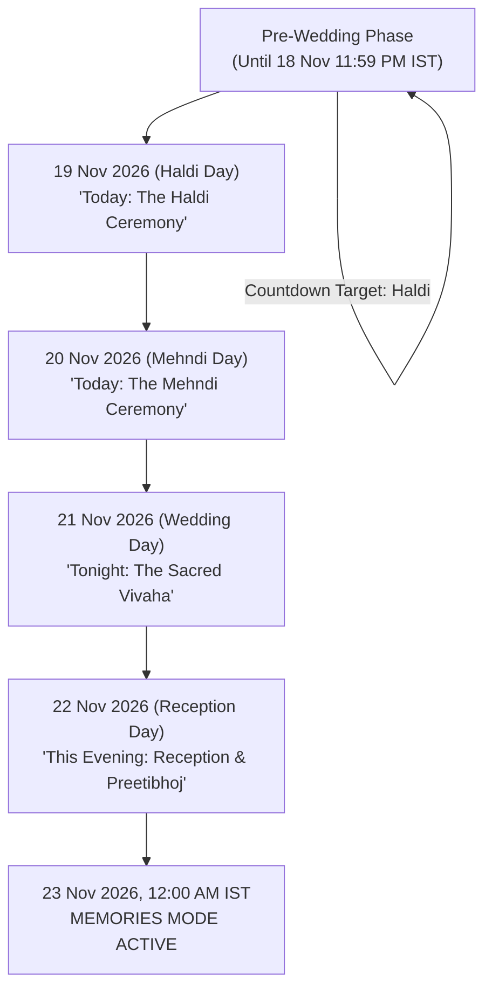

# Mithun & Kabita Wedding Website — Content & Event Data Specification

**Document ID:** `docs/CONTENT_AND_EVENT_DATA.md`  
**Version:** 1.0.0  
**Status:** Authoritative Initial Specification  
**Current Phase:** P-00 — Planning and Specification Only  
**Authoritative Timezone:** `Asia/Kolkata` (IST / UTC+05:30)  
**Public Contact Number:** `6295864148`  
**Requested Public Hostname:** `mithun-kabita-wedding.vercel.app`  

---

## 1. Couple & Family Information

All names and family relationships are recorded exactly as provided without modification or invented biographical detail.

### The Groom
* **Full Name:** Mithun Gorain
* **Primary Display Name:** Mithun
* **Father:** Mr. Kenaram Gorain
* **Mother:** Ms. Savita Gorian *(Spelling as provided; recorded as an exact content entry)*

### The Bride
* **Official Name:** Kabita Gorain
* **Nickname:** Manjura
* **Primary Display Name:** Kabita
* **Father:** Mr. Upen Gorain
* **Mother:** Ms. Kokila Gorain

### Narrative & Hero Directives
* **Homepage Hero Display Title:** **Mithun & Kabita**
* **Couple Presentation Tone:** Modern, graceful, elegant, and reverent.
* **Strict Anti-Fabrication Rule:**
  * No separate, invented "Our Story" romance novel or timeline.
  * No fabricated relationship histories, college stories, or dating anecdotes.
  * The family section must feature **only the couple and their four parents**. Do not add extended relatives, unprovided siblings, occupations, ages, or religious discourses.

---

## 2. Confirmed Wedding Ceremonies & Venues

All dates and times are set in `Asia/Kolkata` (IST). The ceremonies span four consecutive days across two family homes in Purulia district, West Bengal.

### Ceremony 1: Haldi (Turmeric Ceremony)
* **Date:** Thursday, 19 November 2026
* **Start Time:** `9:00 AM IST` (`03:30 AM UTC`)
* **Venue:** Groom's Home
* **Address:** Chitmu, Kotshila, Purulia, West Bengal 723215
* **Google Maps Navigation:** [https://maps.app.goo.gl/Lt8BRMxAEUy371NVA](https://maps.app.goo.gl/Lt8BRMxAEUy371NVA)
* **RSVP Deadline:** 18 November 2026, 11:59:59 PM IST (`18:29:59 UTC`)
* **Ceremonial Significance:** The auspicious purification ritual of turmeric and blessings, marking the commencement of the wedding rites.

### Ceremony 2: Mehndi (Henna Ceremony)
* **Date:** Friday, 20 November 2026
* **Start Time:** `9:00 AM IST` (`03:30 AM UTC`)
* **Venue:** Groom's Home
* **Address:** Chitmu, Kotshila, Purulia, West Bengal 723215
* **Google Maps Navigation:** [https://maps.app.goo.gl/Lt8BRMxAEUy371NVA](https://maps.app.goo.gl/Lt8BRMxAEUy371NVA)
* **RSVP Deadline:** 19 November 2026, 11:59:59 PM IST (`18:29:59 UTC`)
* **Ceremonial Significance:** Traditional adornment of hands and feet with intricate henna patterns amidst music and celebration.

### Ceremony 3: Wedding (The Sacred Vivaha)
* **Date:** Saturday, 21 November 2026
* **Start Time:** `11:00 PM IST` (`17:30 PM UTC`) *(Night Wedding Ceremony)*
* **Venue:** Bride's Home
* **Address:** Ghaghra, Jaipur, Purulia, West Bengal 723201
* **Google Maps Navigation:** [https://maps.app.goo.gl/x1zvibZRTMTNTWCn7](https://maps.app.goo.gl/x1zvibZRTMTNTWCn7)
* **RSVP Deadline:** 20 November 2026, 11:59:59 PM IST (`18:29:59 UTC`)
* **Ceremonial Significance:** The sacred Vedic rituals, Saat Phere (seven circumambulations around the holy fire), and Sindoor Daan solemnizing the marriage.

### Ceremony 4: Reception / Preetibhoj (Feast & Blessings)
* **Date:** Sunday, 22 November 2026
* **Start Time:** `5:00 PM IST` (`11:30 AM UTC`)
* **Venue:** Groom's Home
* **Address:** Chitmu, Kotshila, Purulia, West Bengal 723215
* **Google Maps Navigation:** [https://maps.app.goo.gl/Lt8BRMxAEUy371NVA](https://maps.app.goo.gl/Lt8BRMxAEUy371NVA)
* **RSVP Deadline:** 21 November 2026, 11:59:59 PM IST (`18:29:59 UTC`)
* **Ceremonial Significance:** Grand celebration banquet and reception welcoming the bride to the groom's family and seeking blessings from extended community and guests.

---

## 3. Strict Event End-Time Policy

* **Status:** **Event end times have not been provided.**
* **Mandatory Directive:** **Never fabricate, assume, or calculate event end times.**
  * Do not display arbitrary end times (such as "9:00 AM – 1:00 PM").
  * Do not write fake end times into calendar exports.
  * In `.ics` calendar files, events are formatted either with explicit single start timestamps (`DTSTART`) without `DTEND`, or with standard ceremonial duration notes in the event description.
  * In Google Calendar URLs, omitting the end timestamp or matching `DTSTART` to the event's ceremonial opening preserves standards compliance without misleading guests.

---

## 4. Countdown & Date-Sensitive Narrative Transitions

The homepage countdown and event status banners adapt dynamically based on the current calendar day in `Asia/Kolkata`.

### Transition State Table

| Window in `Asia/Kolkata` | Active Homepage Hero Banner | Target Countdown / Status |
| :--- | :--- | :--- |
| **Now until 18 Nov 2026, 23:59:59** | *"The Auspicious Union Approaches"* | Live countdown to **Haldi: 19 Nov 2026, 9:00 AM IST**. |
| **19 Nov 2026 (00:00:00 – 23:59:59)** | *"Today: The Auspicious Haldi Ceremony"* | Live ceremony status indicator; countdown shifts to Mehndi. |
| **20 Nov 2026 (00:00:00 – 23:59:59)** | *"Today: The Joyous Mehndi Ceremony"* | Live ceremony status indicator; countdown shifts to Wedding. |
| **21 Nov 2026 (00:00:00 – 23:59:59)** | *"Tonight: The Sacred Wedding Ceremony"* | Live ceremony status indicator targeting 11:00 PM IST Vivaha. |
| **22 Nov 2026 (00:00:00 – 23:59:59)** | *"This Evening: Reception & Preetibhoj"* | Live celebration indicator targeting 5:00 PM IST banquet. |
| **23 Nov 2026 (00:00:00 onwards)** | *"Our Wedding Memories"* | **Memories Mode Activated:** Countdown replaced with a timeless welcome to the published photographs and wedding film archive. |

---

## 5. Public Contact & Interactive Channels

The public contact number is **`6295864148`**.

### Contact Protocols
1. **Direct Telephone (`tel:`):**
   * Link format: `<a href="tel:+916295864148">Call +91 6295864148</a>`
   * Opens device phone dialer directly.
2. **WhatsApp Click-to-Chat:**
   * Link format: `https://wa.me/916295864148?text=Hello%20Mithun%20%26%20Kabita%2C%20I%20have%20an%20inquiry%20regarding%20the%20wedding.`
   * **Rule:** The guest must initiate the chat. No automated messaging, broadcasting, or background message scraping.

---

## 6. Digital Invitation Studio Content

The studio supports two distinct artistic expressions:

### Design A: Cinematic Couple Portrait
* **Style:** Modern luxury editorial, full-bleed portrait framing, minimalist typographic lockup.
* **Layout:** Vertical 4:5 aspect ratio, prominent couple name typography, warm champagne tones, subtle Antique Gold hairline borders.
* **Content:**
  * Headline: *"Celebrate the Wedding of"*
  * Main Display: **Mithun & Kabita**
  * Date Banner: *"19 – 22 November 2026 • Purulia, West Bengal"*
  * Verified QR Code with prompt: *"Scan to RSVP & View Directions"*

### Design B: Traditional Royal Indian Invitation
* **Style:** Classical, ornate royal Indian palace decree, architectural Mandap framing, intricate geometric mandala flourishes.
* **Layout:** Warm Luminous Champagne background with Deep Maroon (`#481923`) and Antique Gold (`#B8975E`) decorative frames.
* **Content:**
  * Invocation: *"With the divine blessings of our ancestors and families"*
  * Hosts Announcement:
    * *"Mr. Kenaram Gorain & Ms. Savita Gorian"*
    * *"cordially invite you to celebrate the marriage of their son"*
    * **Mithun**
    * *"with"*
    * **Kabita (Manjura)**
    * *"Daughter of Mr. Upen Gorain & Ms. Kokila Gorain"*
  * Detailed schedule of all four ceremonies with venue addresses.
  * Verified QR Code for digital access.

---

## 7. Persistent Music Player & Calendar Data

### Background Music Player
* **Play/Pause Control:** Accessible via a subtle, floating circular icon on the lower navigation bar.
* **Autoplay Rule:** **Strictly disabled.** Audio plays only upon explicit guest click.
* **State Preservation:** State (playing/paused, track index, volume) is preserved across route transitions using a React Context audio provider.
* **Current Asset Status:** MP3 tracks not yet supplied.
  * **Interim State:** Player UI shows a graceful, dignified tooltip: *"Wedding melodies coming soon."*

### Calendar Integration Specifications
* **Google Calendar Links:**
  * Pre-formatted URLs with ceremony title, start time, venue location, and Google Maps URL.
* **Downloadable `.ics` Files:**
  * Formatted per RFC 5545.
  * Timezone: VTIMEZONE block for `Asia/Kolkata` (Standard Time UTC+05:30).
  * `DTSTART`: Local ceremony start time.
  * `SUMMARY`: e.g., "Mithun & Kabita Wedding — Haldi Ceremony".
  * `LOCATION`: Venue name, full postal address, and Google Maps link.

---

## 8. Outstanding Content & Asset Inventory

The following items are cataloged as external dependencies to be provided prior to final launch:

| Item | Current Status | Interim Design Handling |
| :--- | :--- | :--- |
| **Couple Portrait Photos** | Outstanding | Luminous royal arch framing with intertwined **M & K** monogram. |
| **Wedding Photos (Full)** | Outstanding (Post-Ceremony) | Gallery displays *"Our Wedding Memories Are Coming Soon."* |
| **Wedding Video Highlights** | Outstanding (Post-Ceremony) | Films tab displays *"Ceremonial Films Will Be Published Soon."* |
| **Audio MP3 Files** | Outstanding | Music player displays coming-soon tooltip. |
| **Verified Production URL** | Requested: `mithun-kabita-wedding.vercel.app` | Final QR code generation deferred until domain is verified live. |
| **Google OAuth Client Keys** | Outstanding | Email/password login active; OAuth button awaits credentials. |
