# Mithun & Kabita Wedding Website — Master Phase Roadmap

**Document ID:** `docs/PHASE_ROADMAP.md`  
**Version:** 1.0.0  
**Status:** Authoritative Initial Specification  
**Current Phase:** P-00 — Planning and Specification Only  
**Planning Horizon:** 27 October 2026 – 23 November 2026  
**Primary Timezone:** `Asia/Kolkata` (IST)  

---

## 1. Roadmap Architecture & Milestone Overview

The project is structured into **17 sequential, tightly scoped phases (P-00 through P-16)** organized across **three core milestones**:

```mermaid
flowchart LR
    subgraph MilestoneA["Milestone A: Public Experience & Design"]
        P00["P-00: Planning"] --> P01["P-01: Foundation"]
        P01 --> P02["P-02: Design Tokens"]
        P02 --> P03["P-03: Hero & Nav"]
        P03 --> P04["P-04: Homepage"]
        P04 --> P05["P-05: Public Subpages"]
        P05 --> P06["P-06: Motion & Preview"]
    end

    subgraph MilestoneB["Milestone B: Guest & Admin Engine"]
        P06 --> P07["P-07: Database & RLS"]
        P07 --> P08["P-08: Auth & Approval"]
        P08 --> P09["P-09: Family RSVP Engine"]
        P09 --> P10["P-10: Dashboard & Wishes"]
        P10 --> P11["P-11: Admin Console"]
        P11 --> P12["P-12: Media Management"]
        P12 --> P13["P-13: Invitations & Music"]
        P13 --> P14["P-14: Memories Lifecycle"]
    end

    subgraph MilestoneC["Milestone C: Release & Verification"]
        P14 --> P15["P-15: Quality & Security Audit"]
        P15 --> P16["P-16: Production Launch"]
    end
```



---

## 2. Phase-by-Phase Specifications

### MILESTONE A — DESIGN FOUNDATION AND PUBLIC EXPERIENCE

---

#### Phase P-00: Project Intelligence and Product Specification
* **Milestone:** A
* **Objective:** Establish the comprehensive, authoritative product architecture, creative direction, data contracts, and verification plans without modifying or scaffolding code.
* **Scope Boundaries:** Documentation and planning only. Zero application scaffolding, zero package installation, zero database modifications.
* **Prerequisites:** Workspace established, design skills and MCP tools inspected.
* **Authorized Files:** `docs/PROJECT_BRIEF.md`, `docs/PHASE_ROADMAP.md`, `docs/DESIGN_BIBLE.md`, `docs/ARCHITECTURE_AND_SECURITY.md`, `docs/CONTENT_AND_EVENT_DATA.md`, `docs/ACCEPTANCE_CRITERIA.md`.
* **Main Deliverables:** The six authoritative planning documents.
* **Targeted Testing Requirements:** Internal consistency check across all six files; verification of exact names, dates, times, palette tokens, and deadline logic.
* **Exit Criteria (Definition of Done):** All six documents created and validated; no application source code created; no dependencies installed.

---

#### Phase P-01: Application Foundation & Tooling
* **Milestone:** A
* **Objective:** Initialize the Next.js project structure, TypeScript configuration, Tailwind CSS integration, ESLint/Prettier tooling, and environment variable architecture.
* **Scope Boundaries:** Foundation and build infrastructure only. No UI components or page layouts.
* **Prerequisites:** P-00 completed and approved.
* **Authorized Files:** `package.json`, `tsconfig.json`, `tailwind.config.ts`, `postcss.config.js`, `.eslintrc.json`, `.gitignore`, `.env.example`, `src/app/layout.tsx`, `src/app/page.tsx`, `src/app/globals.css`.
* **Main Deliverables:** Clean Next.js App Router project that compiles with zero TypeScript errors and passes linting; verified `.env.example`.
* **Targeted Testing Requirements:** `npm run build` succeeds; `npm run lint` passes; Tailwind utilities render test colors accurately.
* **Exit Criteria (Definition of Done):** Reproducible build workflow established; clean baseline commit.

---

#### Phase P-02: Visual Identity & Design System Tokens
* **Milestone:** A
* **Objective:** Implement the Luminous Champagne Luxury token architecture, typography primitives, surface styling, ornamental SVG system, and base atomic UI components.
* **Scope Boundaries:** Design tokens, global styles, and atomic components (`Button`, `Divider`, `Ornament`, `Heading`, `Container`). No complex composite sections.
* **Prerequisites:** P-01 completed.
* **Authorized Files:** `src/styles/tokens.css`, `tailwind.config.ts`, `src/components/ui/*`, `src/components/ornaments/*`.
* **Main Deliverables:** CSS token variables, Tailwind color/font extensions, reusable typography components, royal decorative divider components, button and link primitives.
* **Targeted Testing Requirements:** Contrast ratio verification (WCAG 2.1 AA) for `#292322` on `#FFFCF6` and `#F7F1E6`, and `#FFFFFF` on `#A52232` and `#481923`; visual regression of ornamental SVG scaling across viewports.
* **Exit Criteria (Definition of Done):** Design system primitives verified in isolation across dark and light surfaces.

---

#### Phase P-03: Cinematic Navigation and Hero Experience
* **Milestone:** A
* **Objective:** Craft the signature hero section, couple title composition ("Mithun & Kabita"), ceremony teaser, and sticky/floating luxury navigation bar.
* **Scope Boundaries:** Hero section, navigation header, and mobile menu drawer.
* **Prerequisites:** P-02 completed.
* **Authorized Files:** `src/components/navigation/*`, `src/components/hero/*`, `src/app/page.tsx`.
* **Main Deliverables:** Responsive editorial navigation with blur backdrop, responsive hero composition, couple typography, scroll indicator, mobile drawer navigation.
* **Targeted Testing Requirements:** Mobile navigation touch targets (minimum 44x44px); sticky header scroll transition behavior; layout shift checks (CLS = 0) on font and asset loading.
* **Exit Criteria (Definition of Done):** Signature hero renders flawlessly on mobile (320px–428px) and desktop (1440px+); navigation transitions cleanly.

---

#### Phase P-04: Complete Cinematic Homepage
* **Milestone:** A
* **Objective:** Implement all ten major homepage narrative sections with distinctive, cohesive art direction.
* **Scope Boundaries:** The complete single-page homepage narrative flow.
* **Prerequisites:** P-03 completed.
* **Authorized Files:** `src/components/sections/*`, `src/components/cards/*`, `src/app/page.tsx`.
* **Main Deliverables:**
  1. Hero & Ceremony Countdown
  2. Couple Introduction (graceful placeholder framing)
  3. Parents and Family (Mithun's parents & Kabita's parents only)
  4. Celebrations Overview (Haldi, Mehndi, Wedding, Reception)
  5. Venues & Google Maps Directions
  6. Digital Invitation Studio Preview
  7. Wedding Memories Gallery Preview
  8. Approved Wishes Wall Preview
  9. Contact & RSVP Call-to-Action
  10. Refined Editorial Footer
* **Targeted Testing Requirements:** Verification of family names and ceremony dates; Google Maps link opening; responsive grid collapses; zero horizontal scrollbars on mobile.
* **Exit Criteria (Definition of Done):** Full homepage narrative navigates seamlessly end-to-end with no visual defects or placeholder overflows.

---

#### Phase P-05: Public Subpages, SEO and Social Sharing
* **Milestone:** A
* **Objective:** Build dedicated subpages for `/events`, `/gallery`, `/invitation`, `/privacy`, and `/terms`, along with dynamic Open Graph metadata and WhatsApp sharing cards.
* **Scope Boundaries:** Public routes and SEO infrastructure. Private routes remain guarded.
* **Prerequisites:** P-04 completed.
* **Authorized Files:** `src/app/events/page.tsx`, `src/app/gallery/page.tsx`, `src/app/invitation/page.tsx`, `src/app/privacy/page.tsx`, `src/app/terms/page.tsx`, `src/app/sitemap.ts`, `src/app/robots.ts`, `src/components/meta/*`.
* **Main Deliverables:** Complete public routes; empty state for Gallery ("Our Wedding Memories Are Coming Soon"); privacy and terms text; Open Graph image generation and meta tags.
* **Targeted Testing Requirements:** Open Graph preview verification in WhatsApp and Twitter card validators; robots.txt excludes `/admin` and `/dashboard`; all external links open with `rel="noopener noreferrer"`.
* **Exit Criteria (Definition of Done):** All public subpages render cleanly, deliver rich metadata, and exclude private paths from search indexers.

---

#### Phase P-06: Motion, Micro-Interactions and Milestone A Preview
* **Milestone:** A
* **Objective:** Refine subtle scroll-linked entrance animations, text reveals, image transitions, and interactive focus states using `motion/react`, respecting reduced-motion preferences.
* **Scope Boundaries:** Animation polish and interaction refinement across Milestone A.
* **Prerequisites:** P-05 completed.
* **Authorized Files:** Motion wrapper components, interaction hooks, animation token configs.
* **Main Deliverables:** Integrated Motion components; strict `prefers-reduced-motion` compliance fallback; performance audit for smooth 60fps scrolling.
* **Targeted Testing Requirements:** Toggle `prefers-reduced-motion: reduce` in browser and verify animations instantly switch to clean static or simple fade states; check Lighthouse Performance (>90 on mobile).
* **Exit Criteria (Definition of Done):** Milestone A verification passed; preview deployment on Vercel Hobby ready for public review.

---

### MILESTONE B — SECURE GUEST AND ADMIN EXPERIENCE

---

#### Phase P-07: Supabase Data Model, Migrations & Security Foundation
* **Milestone:** B
* **Objective:** Design and apply PostgreSQL database schema, foreign keys, triggers, constraints, Row Level Security (RLS) policies, and server-side Supabase client utilities.
* **Scope Boundaries:** Database schema, migrations, RLS policies, and TypeScript database types.
* **Prerequisites:** Milestone A approved; Supabase project connected.
* **Authorized Files:** `supabase/migrations/*.sql`, `src/lib/supabase/*`, `src/types/database.types.ts`.
* **Main Deliverables:** Production-grade SQL migrations; RLS enabled on all 15 tables; hardened security functions; typed Supabase SSR client utilities.
* **Targeted Testing Requirements:** Direct SQL execution tests verifying RLS prevents unauthorized row reads and writes for anonymous and unprivileged users; verification of constraints.
* **Exit Criteria (Definition of Done):** Database schema fully applied; zero unprotected tables; TypeScript types generated and strictly typed.

---

#### Phase P-07.1: Local Supabase Migration & Security Verification
* **Milestone:** B
* **Objective:** Verify migration reproducibility and automated security test suite on local Docker Supabase environment.
* **Status:** Complete.
* **Results:** Clean reset on local Supabase PostgreSQL 17; seed data verified; 75 pgTAP tests passed (0 failed).

---

#### Phase P-07.2: Profile Approval Security Audit & Anti-Self-Approval Hardening
* **Milestone:** B
* **Objective:** Perform security authorization audit on `profiles.is_approved_guest` and `family_group_id`. Remediate identified self-approval vulnerability via column-level grants, defensive triggers, and audited admin approval procedures.
* **Status:** Complete.
* **Results:** Self-approval vulnerability conclusively identified and remediated via migration `20261101000003_protect_profile_approval.sql`. Permanent regression test `06_profile_approval_security.sql` authored (15 assertions). Full pgTAP suite of 90 tests executed and passed (90 passed, 0 failed). Full TypeScript, ESLint, and Next.js production build checks passed.

---

#### Phase P-08: Authentication, Profiles & Guest Approval Workflow
* **Milestone:** B
* **Objective:** Implement Email/Password and Google OAuth authentication, profile creation, and the administrative Access Request submission and approval/rejection lifecycle.
* **Status:** Complete.
* **Scope Boundaries:** Auth routes, profile management, and access request workflows.
* **Prerequisites:** P-07, P-07.1, P-07.2 completed.
* **Authorized Files:** `src/app/login/*`, `src/app/register/*`, `src/app/forgot-password/*`, `src/app/update-password/*`, `src/app/auth/*`, `src/app/account/*`, `src/app/admin/access-requests/*`, `src/components/auth/*`, `src/components/account/*`, `src/components/admin/*`, `src/actions/*`, `src/lib/supabase/*`, `src/proxy.ts`.
* **Main Deliverables:** Cookie-based session integration using official `@supabase/ssr` and Next.js 16 `src/proxy.ts`; registration, login, logout, password recovery; profile viewer/editor; access request submission, pending isolation, and rejection resubmission; focused administrative review console with atomic approval, rejection with mandatory reason, and family assignment; updated Privacy Policy.
* **Targeted Testing Requirements:** 10 live authentication and workflow checks passed; 102 pgTAP security tests passed (100% pass across 7 test suites); Next.js 16 production build passed with 23 routes.
* **Exit Criteria (Definition of Done):** End-to-end auth and access request loop verified for both accepted and rejected guest paths with trusted server-side authorization.
* **Exit Criteria (Definition of Done):** End-to-end auth and access request loop verified for both accepted and rejected guest paths.

---

#### Phase P-09: Family Management & Ceremony-Specific RSVP Engine
* **Milestone:** B
* **Objective:** Build the family grouping system, single active manager assignment/transfer, and the ceremony-specific RSVP engine with mandatory attendee validation and strict deadline locking.
* **Status:** Complete.
* **Scope Boundaries:** Family groupings, RSVP manager permissions, ceremony RSVP forms, server-side deadline validation, and administrator RSVP intelligence.
* **Prerequisites:** P-08 completed.
* **Authorized Files:** `src/actions/rsvp.ts`, `src/components/rsvp/*`, `src/components/admin/*`, `src/app/account/*`, `src/app/admin/rsvps/*`, `src/app/privacy/page.tsx`, `supabase/migrations/*`, `supabase/tests/*`.
* **Main Deliverables:**
  * Versioned PostgreSQL migration `20261101000005_family_rsvp_engine.sql` adding `public.check_attendee_rsvp_deadline`, hardening `public.check_rsvp_deadline` for DELETE, creating atomic `public.submit_family_rsvp`, and creating `public.get_admin_rsvp_report`.
  * Ceremony-by-ceremony RSVP engine supporting `attending`, `not_attending`, `not_sure`, and derived `no_response` calculation.
  * Mandatory attendee validation requiring at least one attendee with trimmed non-empty names and valid age categories (`adult`, `child`, `infant`) when attending.
  * Headcount strictly derived from child attendee records with automatic atomic purging on decline/unsure.
  * Safe storage of optional arrival information and dietary/special requests without leakage to other families or public directories.
  * Strict deadline locking enforcing cutoff at 11:59:59 PM IST on the preceding day for each ceremony, blocking mutations across both parent RSVPs and child attendees for all roles including administrators.
  * Role-based Family RSVP dashboard integrated into `/account` (unapproved guests view access request status; approved non-managers view read-only attendance; active managers manage ceremony RSVPs pre-deadline and see locked state post-deadline).
  * Dedicated Administrator RSVP reporting page at `/admin/rsvps` guarded by `guest_rsvp` admin permission with ceremony summaries, derived response breakdowns, dynamic headcounts, and family drilldown, with zero CSV/Excel exports.
  * Permanent regression test suite `08_family_rsvp_workflow.sql` (17 assertions, bringing total to 119 passing pgTAP tests).
  * Updated Privacy Policy detailing family RSVP engine, attendee data collection, and confidentiality rules.
* **Targeted Testing Requirements:** 17 pgTAP assertions passed in suite 08 (119 total tests passing across 8 suites); live E2E programmatic integration passed with disposable identity; Next.js 16 production build passed with 24 routes.
* **Exit Criteria (Definition of Done):** Zero late submissions permitted; attendance headcount accurately derived from child attendee records; administrator intelligence verified with zero CSV/Excel export vulnerabilities.

---

#### Phase P-10: Guest Dashboard, Public Wishes & Private Conversations [COMPLETED]
* **Milestone:** B
* **Status:** Complete (Migration 6, 23 pgTAP tests, Server Actions, Client Components, Admin Curations, Next.js 16 build passing)
* **Objective:** Complete the guest-facing dashboard, moderated public wishes submission/editing, and the private 1-to-1 guest-to-admin question and request thread.
* **Scope Boundaries:** Guest dashboard interface, wishes submission flow, and private question thread.
* **Prerequisites:** P-09 completed.
* **Authorized Files:** `src/app/(guest)/dashboard/*`, `src/actions/wishes.ts`, `src/actions/conversations.ts`, `src/components/dashboard/*`.
* **Main Deliverables:** Clean status dashboard; wish creation/edit modal (edits return to pending state); private message thread with `New` / `In Progress` / `Resolved` status tracking; self-service account deletion workflow.
* **Targeted Testing Requirements:** Verify editing an approved wish immediately hides it from the public feed until re-moderated; verify Guest A cannot view Guest B's private messages; verify account deletion retains published wish as "Guest" and preserves family RSVP history.
* **Exit Criteria (Definition of Done):** Guest dashboard, wish moderation loop, and private messaging operational with zero data cross-leakage.

---

#### Phase P-11: Admin Console, Permission Matrix & Notifications [COMPLETED]
* **Milestone:** B
* **Status:** Complete (Migration 7, 18 pgTAP tests in Suite 10 [161 total], 26 Node.js integration tests, Unified Dashboard, AdminHeader, Super Admin Team Manager, Server Actions, Dynamic Next.js 16 routes passing).
* **Objective:** Implement the central administrative console, enforcing the single Super Admin role, six granular permission groups, ceremony headcount reporting, and permission-scoped notifications.
* **Scope Boundaries:** `/admin` routes, permission verification middleware, admin dashboards, notification center.
* **Prerequisites:** P-10 completed.
* **Authorized Files:** `src/app/admin/*`, `src/components/admin/*`, `src/actions/admin-management.ts`, `supabase/migrations/20261101000007_admin_dashboard_and_notifications.sql`, `supabase/tests/10_admin_dashboard_and_notifications.sql`.
* **Main Deliverables:**
  * Versioned PostgreSQL Migration `20261101000007_admin_dashboard_and_notifications.sql`: Partial unique index `idx_single_super_admin`, notification triggers, `get_admin_dashboard_metrics`, `get_admin_team`, `admin_manage_admin_user`, `admin_mark_notification_read`, `admin_mark_all_notifications_read`.
  * Dedicated Executive Admin Overview Portal at `/admin` (`src/app/admin/page.tsx`).
  * Unified luxury top navigation `<AdminHeader />` deployed across all 5 admin sections (`/admin`, `/admin/access-requests`, `/admin/rsvps`, `/admin/wishes`, `/admin/conversations`).
  * Interactive Notification Center `<AdminNotificationsDrawer />` with unread count badge, real-time trigger sync, and single/batch mark-read controls.
  * Super Admin Team Manager (`<AdminTeamManager />`) restricted exclusively to Super Admin, with active status toggle and 6 permission groups (`guest_rsvp`, `photos`, `wishes`, `questions`, `events_website`, `invitation_studio`).
  * Server actions in `src/actions/admin-management.ts` with server-side Super Admin and permission validation.
  * 18 pgTAP assertions in `supabase/tests/10_admin_dashboard_and_notifications.sql` bringing total passing database tests to 161 across 10 suites.
  * End-to-end integration test suite `scripts/test_p11_admin_dashboard.mjs` verifying zero data leakage across 26 test cases.
* **Targeted Testing Requirements:** 18/18 pgTAP assertions passed (161/161 tests passed across all 10 suites); 26/26 Node.js integration assertions passed; TypeScript typecheck passed with zero errors.
* **Exit Criteria (Definition of Done):** Single Super Admin rule strictly enforced at schema and RPC level; all six permission boundaries verified; zero data leakage in dashboard metrics; notifications center operational.

---

#### Phase P-12: Media Manager & Published Gallery Integration [COMPLETED]
* **Milestone:** B
* **Status:** Complete (Migration 8, 19 pgTAP tests in Suite 11 [180 total across 11 suites], 24 Node.js integration tests in Suite 12, Media Manager at `/admin/media`, gatekeeper route at `/api/media/[id]`, client-side canvas compression, download toggles, YouTube privacy embeds, dynamic gallery hydration).
* **Objective:** Build the secure photo upload pipeline, private draft review workflow, preview and publication mechanism, image download toggles, and YouTube video integration.
* **Scope Boundaries:** Admin media management and public gallery hydration.
* **Prerequisites:** P-11 completed.
* **Authorized Files:** `src/app/admin/media/*`, `src/actions/media.ts`, `src/app/gallery/*`, `src/app/api/media/*`, `src/lib/youtube.ts`, `supabase/migrations/20261101000008_media_manager_and_gallery.sql`, `supabase/tests/11_media_manager_and_gallery.sql`.
* **Main Deliverables:**
  * Versioned PostgreSQL Migration `20261101000008_media_manager_and_gallery.sql`: Payload constraints (`chk_media_payload`), performance indices, RPCs `get_published_media`, `admin_get_all_media`, `admin_create_media_item`, `admin_update_media_item`, `admin_delete_media_item`, `admin_toggle_media_published`, `admin_toggle_media_download`, and dashboard metrics integration (`photos_metrics`).
  * Private Draft Storage & Gatekeeper (`/api/media/[id]`): Storage files located in private directory `storage/media/` outside `public/`; server-side session checks enforce that unapproved drafts are strictly blocked with 403 Forbidden to guests and non-photo admins.
  * Image Download Controls: Granular `download_enabled` flag toggled by admins; downloads served with attachment headers; when disabled, download buttons are omitted and client prevents right-click save and dragging.
  * YouTube Video Integration: Link registration and normalizer supporting standard, short, and unlisted YouTube ceremony videos, embedded via `youtube-nocookie.com` with responsive 16:9 ratio and ceremony badging.
  * Dedicated Photo & Media Console (`/admin/media`): Multi-file image uploader with off-screen HTML Canvas compression, category selectors, publication toggles, download permission controls, and video registration.
  * Hydrated Public Gallery (`/gallery`): Server component fetching published media, interactive category filtering, lightbox viewer, and backward-compatible coming-soon empty states.
  * 19 pgTAP assertions in `supabase/tests/11_media_manager_and_gallery.sql` bringing total passing database tests to 180 across 11 suites.
  * End-to-end integration test suite `scripts/test_p12_media_and_gallery.mjs` verifying zero data leakage across 24 test cases.
* **Targeted Testing Requirements:** 19/19 pgTAP assertions passed (180/180 tests passed across all 11 suites); 24/24 Node.js integration assertions passed; TypeScript typecheck and ESLint passed with zero errors; Next.js 16 build passed with 28 routes.
* **Exit Criteria (Definition of Done):** Photo and video workflows operating securely from private draft to public display with zero guest data leakage.

---

#### Phase P-13: Digital Invitation Studio & Wedding Utilities [COMPLETED]
* **Milestone:** B
* **Status:** Complete (Migration 9 applied, 198/198 pgTAP tests passing, 34/34 Node integration tests passing, production build 29/29 routes passing).
* **Objective:** Implement the two distinct digital invitation designs (Design A: Cinematic Couple Portrait; Design B: Traditional Royal Indian), PNG/PDF export, verified QR code generation, Google Calendar links, `.ics` downloads, and the persistent music player.
* **Scope Boundaries:** Invitation generation, calendar integrations, and music player audio bridge.
* **Prerequisites:** P-12 completed.
* **Authorized Files:** `src/components/invitation/*`, `src/components/audio/*`, `src/lib/calendar.ts`, `src/lib/qr-code.ts`, `src/lib/invitation-export.ts`, `src/app/invitation/*`, `src/app/admin/invitation/*`, `src/actions/invitation.ts`.
* **Main Deliverables:** Interactive invitation studio with template switcher; high-resolution 1200x1600 HTML5 Canvas PNG generator; printable PDF renderer via `@media print`; standards-compliant RFC 5545 calendar files (.ics and Google Calendar) with local start times and zero invented end times; persistent audio player mounted in root layout with graceful coming-soon fallback; administrative invitation console and permissions.
* **Targeted Testing Requirements:** Downloaded PNG and PDF render with crisp vector ornaments and accurate typography; calendar `.ics` imports cleanly into Google Calendar and Apple Calendar with correct `Asia/Kolkata` start times; music player does not autoplay and maintains state across route navigation.
* **Exit Criteria (Definition of Done):** Invitations export cleanly; calendar events import accurately; music player operates reliably across routes. All criteria verified and passed.

---

#### Phase P-14: Memories Mode & Lifecycle Governance [COMPLETED]
* **Milestone:** B
* **Status:** Complete (Verified with 32 integration tests, 217 pgTAP database security tests, and 29 Next.js 16 production routes compiled cleanly).
* **Objective:** Implement the authoritative post-wedding lifecycle transition (*Memories Mode*) triggering precisely at 23 November 2026, 12:00 AM IST.
* **Scope Boundaries:** Global application lifecycle logic, public page adaptation, submission freezing.
* **Prerequisites:** P-13 completed.
* **Authorized Files:** `src/lib/lifecycle.ts`, `src/middleware.ts`, public components and server actions.
* **Main Deliverables:** Server-side lifecycle state machine evaluating authoritative server clock in `Asia/Kolkata`; public UI shift to celebrate captured memories; automatic closure of new registrations, new access requests, new wishes, and new private threads; preservation of admin media management and existing user profile controls.
* **Targeted Testing Requirements:** Clock-mocking tests verifying behavior at 22 Nov 2026 11:59:59 PM IST (pre-transition) vs 23 Nov 2026 12:00:00 AM IST (post-transition); API rejections for new submissions post-transition.
* **Exit Criteria (Definition of Done):** Complete application locks submissions and adapts narrative at the exact minute boundary without data corruption.

---

### MILESTONE C — QUALITY, DEPLOYMENT AND RELEASE

---

#### Phase P-15: Full Quality, Security & Accessibility Audit [COMPLETED]
* **Milestone:** C
* **Status:** Complete (Verified with 229 automated browser QA tests across Desktop, Tablet, and Mobile viewports, 217 pgTAP database security tests, 34 P-13 tests, 24 P-12 tests, 32 P-14 tests, and 29 Next.js 16 production routes compiled with 0 errors and 0 warnings).
* **Objective:** Execute an exhaustive verification protocol across the entire application covering mobile responsiveness, WCAG 2.1 AA accessibility, security penetration testing, RLS boundary verification, performance optimization, and bug remediation.
* **Scope Boundaries:** Testing, code auditing, defect fixing, performance tuning across the entire repository.
* **Prerequisites:** Milestone B completed.
* **Authorized Files:** Bug fixes and optimization tweaks across `src/*`.
* **Main Deliverables:** Comprehensive test execution report; resolved defect log; accessibility compliance report; Core Web Vitals optimization scorecards (LCP < 2.5s, CLS < 0.1, FID/INP < 100ms).
* **Targeted Testing Requirements:** Automated RLS bypass test suite; mobile device testing across iOS Safari and Android Chrome; keyboard-only navigation test; screen reader announcements; simulated network throttling.
* **Exit Criteria (Definition of Done):** Zero open high or critical defects; WCAG 2.1 AA pass; all acceptance criteria in `docs/ACCEPTANCE_CRITERIA.md` validated.

---

#### Phase P-16: Production Deployment, Configuration & Launch
* **Milestone:** C
* **Objective:** Execute the production deployment checklist on Vercel and Supabase, configure custom domains, verify social cards, finalize the verified QR code, and validate production monitoring.
* **Scope Boundaries:** Production deployment, DNS/domain verification, production smoke testing, handoff documentation.
* **Prerequisites:** P-15 completed and approved.
* **Authorized Files:** Deployment configurations, production environment variable verifications, production release documentation.
* **Main Deliverables:** Live production deployment at verified URL; verified production QR code; documented manual Supabase CLI database export and Storage backup runbook; operational unpausing and recovery guide.
* **Targeted Testing Requirements:** Production smoke test of public navigation, guest login, access request, and admin console; live WhatsApp link and Google Maps verification on physical mobile devices.
* **Exit Criteria (Definition of Done):** Production release fully operational, verified secure, and handed off with complete documentation.

---

## 3. Dependency Graph & Critical Path

```text
P-00 (Spec) ──> P-01 (Foundation) ──> P-02 (Design Tokens) ──> P-03 (Hero & Nav) ──> P-04 (Homepage) ──> P-05 (Subpages) ──> P-06 (Motion & Preview)
                                                                                                                          │
                                                                                                                          ▼
P-12 (Media) <── P-11 (Admin) <── P-10 (Dashboard) <── P-09 (RSVP) <── P-08 (Auth) <── P-07 (Database & RLS)
     │
     ▼
P-13 (Invitation Studio) ──> P-14 (Memories Mode) ──> P-15 (Audit) ──> P-16 (Production Launch)
```

### Critical Path Constraints
1. **P-02 (Tokens) is prerequisite for all UI:** No page or component may be styled with arbitrary ad-hoc hex values before tokens are locked.
2. **P-07 (Database) is prerequisite for all authenticated flows:** Schema, constraints, and RLS must be in place before building UI for auth, RSVPs, or admin.
3. **P-09 (RSVP) strictly requires P-08 (Auth):** Family grouping and manager assignment cannot be implemented without user profiles and access requests.
4. **P-14 (Memories Mode) requires complete public and guest flows:** Lifecycle freezing logic must wrap around established submission endpoints.
5. **P-16 strictly requires P-15:** No production release can occur without passing the comprehensive quality and security audit.

---

## 4. Delivery Schedule, Priorities & Risk Management

### Timeline Overview
* **Current Planning Date:** 27 October 2026
* **Target Milestone A Completion:** 03 November 2026 (Public Preview Ready)
* **Target Milestone B Completion:** 12 November 2026 (Guest Engine & Admin Live)
* **Target Milestone C Completion:** 16 November 2026 (Production Release & Invitations Dispatched)
* **Ceremony Dates:** 19 November – 22 November 2026
* **Memories Transition:** 23 November 2026, 12:00 AM IST

### Phased Prioritization Principles
1. **Public Experience First:** If family photo assets are delayed, the public website launches with architectural placeholders; ceremony details and map locations remain immediately available.
2. **Strict Security Non-Negotiable:** Under no circumstance will RSVP deadlines, authentication checks, or RLS policies be weakened or bypassed to accelerate deployment.
3. **Graceful Degradation for Audio/Media:** If custom MP3s or YouTube links are not ready at launch, the respective UI blocks gracefully display elegant "Coming Soon" states rather than breaking.
4. **Supabase Inactivity Risk Management:** Supabase Free projects may be paused by the platform after a period of insufficient activity. Sending health checks is not a guaranteed prevention method, and no automated health check or backup routine is currently running. Operational procedures rely on manual project monitoring via the Supabase dashboard, documented manual CLI database dumps (`supabase db dump`) with off-site storage, and separate manual backups of Supabase Storage media objects. Continuous service availability is not guaranteed on free-tier hosting.
