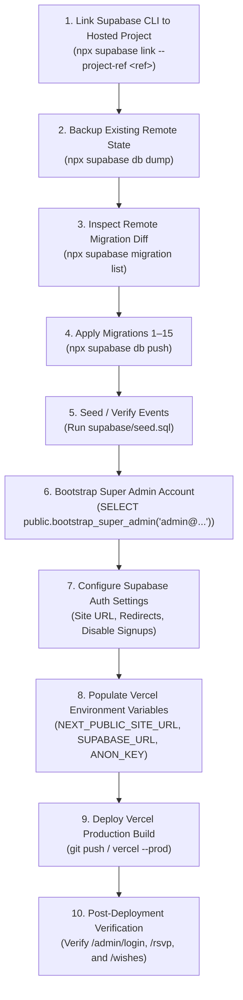

# Supabase Database & Admin Authentication Production Readiness Audit

**Project:** Mithun & Sakhi Wedding Celebration Website  
**Production Deployment Target:** Vercel (`https://mithun-sakhi-wedding.vercel.app`)  
**Audit Date:** November 11, 2026  
**Auditor:** Antigravity AI Engineering Suite  
**Scope:** Read-Only Infrastructure, Schema, RLS, Storage, Auth, and Configuration Audit  
**Operating Mode:** Audit-Only (Zero modifications made to remote databases, users, or policies)

---

## Executive Summary Matrix

| Section | Audit Dimension | Status | Key Finding / Operational Action |
| :--- | :--- | :--- | :--- |
| **1** | Current Supabase Connection | **NEEDS CONFIGURATION** | Local client points to `http://127.0.0.1:54321`. Hosted project URL & anon keys must be populated on Vercel. |
| **2** | Database Schema Inventory | **READY** | All 17 tables, types, constraints, triggers, and functions are fully specified in SQL migrations. |
| **3** | Migration Readiness | **NEEDS MIGRATION** | 15 canonical migrations exist in `supabase/migrations/`. Remote database must be linked and verified before deployment. |
| **4** | RSVP Security Readiness | **READY** | Anonymous public submissions via `submit_public_rsvp` RPC; RLS restricts table access strictly to admins. |
| **5** | Wishes Security Readiness | **READY** | Public submissions forced to `pending`; public SELECT strictly filtered by `status = 'approved'`. |
| **6** | Admin Authentication Readiness | **READY** | Dedicated `/admin/login` active; dual-layer edge proxy + server guards enforce `admin_users.is_active = true`. |
| **7** | Storage Readiness | **NEEDS CONFIGURATION** | Core site assets are bundled in `public/`. Dynamic admin uploads currently target local disk and require Supabase Storage setup for persistent cloud storage. |
| **8** | Required Vercel Environment Variables | **NEEDS CONFIGURATION** | 4 mandatory environment variables identified; must be entered in Vercel project settings. |
| **9** | Supabase Production Auth Settings | **NEEDS CONFIGURATION** | Site URL and Redirect URLs must match `https://mithun-sakhi-wedding.vercel.app`. Public signup can be disabled. |
| **10** | Backup Requirements | **READY** | Backup strategy formulated using pg_dump / Supabase dashboard snapshots prior to migration rollout. |
| **11** | Critical Blockers | **NEEDS CONFIGURATION** | Remote database linking, migration push, and admin bootstrapping required prior to public launch. |
| **12** | Recommended Deployment Sequence | **READY** | Step-by-step phased deployment checklist established. |

---

## 1. Current Supabase Connection Audit

### Current Configuration Analysis
- **Target URL in `.env.local`:** `http://127.0.0.1:54321` (Local Supabase instance).
- **Target Project ID in `supabase/config.toml`:** `project_id = "mithun-kabita-wedding"`.
- **Remote Link State:** **Unlinked.** Executing `npx supabase migration list` returns `ProjectRefNotLinkedError: Cannot find project ref. Have you run supabase link?`.
- **Local Container State:** Port `54321` is closed locally (Docker container offline).

### Client Initialization Verification
The application utilizes `@supabase/ssr` (v0.12.7) across three distinct execution layers:
1. **Browser Client (`src/lib/supabase/client.ts`):** Initializes via `createBrowserClient(url, key)`. Reads `NEXT_PUBLIC_SUPABASE_URL` and `NEXT_PUBLIC_SUPABASE_PUBLISHABLE_KEY` (with fallback to `NEXT_PUBLIC_SUPABASE_ANON_KEY`).
2. **Server Client (`src/lib/supabase/server.ts`):** Initializes via `createServerClient(url, key)` with `next/headers` cookie management (`getAll` / `setAll`), providing PKCE token persistence and session refresh for Server Components and Server Actions.
3. **Edge Proxy Layer (`src/lib/supabase/proxy.ts`):** Replaces legacy middleware using Next.js 16 Proxy conventions. Refreshes tokens and intercepts unauthenticated access before route rendering.

### Hardcoding & Secret Leak Assessment
- **Hardcoded URLs:** **0 found.** All Supabase clients dynamically read environment variables.
- **Secret Keys:** No service role keys or client secrets are hardcoded in the codebase.
- **Fail-Safe Checks:** Both `client.ts` and `server.ts` explicitly throw clear descriptive runtime exceptions if `NEXT_PUBLIC_SUPABASE_URL` or key variables are missing.

---

## 2. Database Schema Inventory

The application database architecture comprises **17 relational tables**, all governed by Row Level Security (RLS):

| Table Name | Purpose | Primary Key | Key Columns | RLS Status | Public Access | Admin Access |
| :--- | :--- | :--- | :--- | :--- | :--- | :--- |
| **`public_rsvps`** | Public RSVP submissions (New Architecture) | `id` (UUID) | `guest_name`, `mobile_number`, `address`, `relationship`, `guest_count`, `attending_*`, `status` | **ENABLED** | Insert via RPC only; 0 Direct SELECT/UPDATE/DELETE | Full SELECT, UPDATE, DELETE via `is_admin()` |
| **`wishes`** | Guestbook blessings & wishes | `id` (UUID) | `profile_id`, `author_display_name`, `wish_text`, `status`, `moderated_by`, `moderated_at` | **ENABLED** | SELECT where `status = 'approved'`; Insert via RPC only | Full moderation & DELETE via `wishes` permission |
| **`events`** | Ceremonies (Haldi, Mehndi, Wedding, Reception) | `id` (TEXT) | `slug`, `title`, `ceremony_date`, `start_time_ist`, `venue_name`, `rsvp_deadline_utc`, `is_published` | **ENABLED** | SELECT (Anon & Auth) | Full manage via `events_website` permission |
| **`admin_users`** | Authorized administrative personnel | `id` (UUID) | `id` (FK `auth.users`), `is_super_admin`, `is_active` | **ENABLED** | None | SELECT (Self/Admin); Manage (Super Admin) |
| **`admin_permissions`** | Granular admin permission assignments | `id` (UUID) | `admin_id`, `permission_group` (`guest_rsvp`, `photos`, `wishes`, `questions`, etc.) | **ENABLED** | None | SELECT (Self/Admin); Manage (Super Admin) |
| **`admin_notifications`** | Internal admin activity alerts | `id` (UUID) | `permission_group`, `title`, `message`, `related_entity_id`, `is_read` | **ENABLED** | None | SELECT & UPDATE where user holds matching permission |
| **`media_items`** | Gallery photographs & videos metadata | `id` (UUID) | `media_type`, `storage_path`, `youtube_url`, `category`, `caption`, `is_published`, `download_enabled` | **ENABLED** | SELECT where `is_published = true` | Full manage via `photos` permission |
| **`invitation_settings`** | Digital studio typography & QR config | `id` (TEXT) | `headline_text`, `intro_text`, `qr_code_target_url`, `is_published` | **ENABLED** | SELECT where `is_published = true` | Full manage via `invitation_studio` permission |
| **`profiles`** | Authenticated user profiles (Admins/Legacy) | `id` (UUID) | `full_name`, `email`, `mobile_number`, `is_approved_guest`, `family_group_id` | **ENABLED** | None | SELECT own profile or all profiles (Admin) |
| **`family_groups`** | Household groups (Legacy Auth RSVP) | `id` (UUID) | `name`, `notes`, `created_by` | **ENABLED** | None | SELECT (Household member); Manage (Admin) |
| **`family_members`** | Household roster members | `id` (UUID) | `family_group_id`, `name` | **ENABLED** | None | SELECT/UPDATE (Household member); Manage (Admin) |
| **`family_managers`** | Household RSVP manager assignments | `id` (UUID) | `family_group_id`, `profile_id`, `is_active` | **ENABLED** | None | SELECT (Own household); Manage (Super Admin) |
| **`access_requests`** | Guest verification requests | `id` (UUID) | `profile_id`, `invited_family_name`, `relationship_to_couple`, `status` | **ENABLED** | None | SELECT own; Review via `guest_rsvp` admin |
| **`rsvps`** | Household ceremony RSVP records | `id` (UUID) | `event_id`, `family_group_id`, `submitted_by`, `status` | **ENABLED** | None | SELECT own household; Manage (Admin) |
| **`attendees`** | Individual attendees per ceremony | `id` (UUID) | `rsvp_id`, `full_name`, `age_category` | **ENABLED** | None | SELECT own household; Manage (Admin) |
| **`conversations`** | Host Q&A message threads | `id` (UUID) | `profile_id`, `status` | **ENABLED** | None | SELECT own thread; Manage (`questions` admin) |
| **`conversation_messages`** | Individual thread messages | `id` (UUID) | `conversation_id`, `sender_id`, `message_body`, `is_from_admin` | **ENABLED** | None | SELECT own thread; Insert own / admin reply |

---

## 3. Migration Readiness

### Migration File Audit (`supabase/migrations/`)
The repository contains **15 ordered, standalone migration scripts**:
1. `20261101000001_initial_schema.sql`: Core tables, constraints, updated_at triggers, and `bootstrap_super_admin` function.
2. `20261101000002_security_and_rls.sql`: RLS enablement on all tables and 41 comprehensive security policies.
3. `20261101000003_protect_profile_approval.sql`: Privilege escalation guards on profile fields.
4. `20261101000004_access_request_workflow.sql`: Eligibility validation and administrative review RPCs.
5. `20261101000005_family_rsvp_engine.sql`: Ceremony deadline locking and household submission engine.
6. `20261101000006_wishes_and_conversations.sql`: Guestbook triggers, moderation RPC, and column-level privileges.
7. `20261101000007_admin_dashboard_and_notifications.sql`: Admin notifications, permission engine, and team management.
8. `20261101000008_media_manager_and_gallery.sql`: Gallery publication RPCs and media intelligence.
9. `20261101000009_invitation_studio_and_utilities.sql`: Digital invitation studio configuration RPCs.
10. `20261101000010_memories_mode_lifecycle.sql`: Wedding lifecycle state transitions and post-wedding lockdown.
11. `20261101000011_homepage_featured_media.sql`: Featured media curators and homepage spotlight RPCs.
12. `20261101000012_login_based_family_rsvp.sql`: Household member roster and attendee selection.
13. `20261101000013_p17_security_hardening.sql`: Security patch for household initialization.
14. `20261101000014_public_anonymous_wishes.sql`: `submit_public_wish` RPC enabling anonymous guestbook blessings.
15. `20261101000015_public_rsvp_system.sql`: `public_rsvps` table, `submit_public_rsvp` RPC, and `get_admin_public_rsvps` RPC.

### Migration Safety & Idempotency
- **Destructive Statements:** Zero destructive `DROP TABLE` operations on core data tables.
- **Idempotency:** Policies use `DROP POLICY IF EXISTS ... CREATE POLICY`. Tables use `CREATE TABLE IF NOT EXISTS`. Functions use `CREATE OR REPLACE FUNCTION`.
- **Search Path Hardening:** All critical security definer functions explicitly include `SET search_path = ''` to prevent search path hijacking.

---

## 4. RSVP Database & Security Audit

### Public RSVP Architecture
The production RSVP flow operates entirely without guest authentication:
- **Public Route:** `/rsvp`
- **Target Table:** `public.public_rsvps`
- **Database Insertion Method:** `public.submit_public_rsvp(...)` RPC function.

### Security Guarantees
1. **Anonymous Submission Permitted:** The RPC is explicitly granted to `anon` and `authenticated`:
   ```sql
   GRANT EXECUTE ON FUNCTION public.submit_public_rsvp TO anon, authenticated;
   ```
2. **Direct Table Access Denied:**
   - Public and anonymous roles have **0 SELECT, 0 UPDATE, and 0 DELETE permissions** on `public.public_rsvps`.
   - Guests cannot inspect or harvest other guests' names, addresses, or phone numbers.
3. **Data Sanitization & Anti-Spam:**
   - Server-side regex strips HTML/script tags (`REGEXP_REPLACE(..., '<[^>]*>', '', 'g')`).
   - Anti-bot honeypot: Automated bot submissions with filled honeypot fields are silently absorbed with fake success IDs.
   - Name length bounded to 2–100 characters. Guest count clamped between 1 and 50.
4. **Lifecycle Cutoff Enforcement:**
   - Submissions automatically lock once Memories Mode activates on **2026-11-22 18:30:00+00**.
5. **Administrative Retrieval:**
   - Admin retrieval is restricted strictly to verified administrators via `public.get_admin_public_rsvps()` and table RLS:
   ```sql
   CREATE POLICY "Admins can view public rsvps" ON public.public_rsvps FOR SELECT USING (public.is_admin());
   ```

---

## 5. Wishes & Blessings Security Audit

### Guestbook Architecture
- **Submission Action:** [`submitPublicWishAction`](file:///C:/Users/Rabin%20Gorain/Downloads/mithun-sakhi-wedding/src/actions/wishes.ts) invoking `public.submit_public_wish(...)`.
- **Target Table:** `public.wishes`

### Security Guarantees
1. **Initial Status Quarantine:** All new submissions are guaranteed to enter `pending` status. Even if a caller attempts to pass `status = 'approved'`, the database trigger `trg_wishes_handle_submission` forces:
   ```sql
   NEW.status := 'pending';
   NEW.moderated_by := NULL;
   NEW.moderated_at := NULL;
   ```
2. **Zero Public Visibility of Pending Wishes:**
   The `wishes_select_anon` policy guarantees that unapproved wishes cannot be queried:
   ```sql
   CREATE POLICY "wishes_select_anon" ON public.wishes FOR SELECT TO anon USING (status = 'approved');
   ```
3. **Column-Level Least Privilege:**
   Direct query privilege for `anon` is restricted strictly to safe public display columns:
   ```sql
   REVOKE ALL ON public.wishes FROM anon;
   GRANT SELECT (id, author_display_name, wish_text, created_at) ON public.wishes TO anon;
   ```
4. **Administrative Moderation:**
   Only users holding the `wishes` permission group (or Super Admin) can transition wishes to `approved` or `rejected` via `public.admin_moderate_wish`.

---

## 6. Admin Authentication Audit

### Dedicated Executive Portal
- **Exact Admin Login URL:** [**/admin/login**](https://mithun-sakhi-wedding.vercel.app/admin/login)
- **Public Navigation Isolation:** The public navbar contains **0 "Account" links** and **0 "Admin" links**.
- **Robots / Indexing:** `/admin/login` specifies `robots: { index: false, follow: false }`.

### Multi-Tier Authentication & Access Verification
1. **Credential Authentication:**
   Authenticates through Supabase Auth via `supabase.auth.signInWithPassword({ email, password })`.
2. **Server-Side Admin Role Verification:**
   Immediately following credential validation, [`adminSignInAction`](file:///C:/Users/Rabin%20Gorain/Downloads/mithun-sakhi-wedding/src/actions/auth.ts#L159-L173) queries `public.admin_users`:
   ```sql
   SELECT id, is_active, is_super_admin FROM public.admin_users WHERE id = authData.user.id;
   ```
   If the user does not exist in `admin_users` or has `is_active = false`, the session is **immediately revoked (`supabase.auth.signOut()`)** and returns an explicit access denial.
3. **Edge Route Protection (`src/lib/supabase/proxy.ts`):**
   Intercepts unauthenticated requests targeting `/admin` or `/admin/*` (excluding `/admin/login`) and issues a 307 redirect to `/admin/login?redirect=<target>`.
4. **Server Component Guards:**
   Every dashboard subpage executes server-side validation:
   - `/admin`: `requireAnyAdmin("/admin")`
   - `/admin/rsvps`: `requireAdmin("guest_rsvp")`
   - `/admin/wishes`: `requireAdmin("wishes")`
   - `/admin/media`: `requireAdmin("photos")`
   - `/admin/invitation`: `requireAdmin("invitation_studio")`
   - `/admin/conversations`: `requireAdmin("questions")`
   - `/admin/access-requests`: `requireAdmin("guest_rsvp")`
5. **Session Invalidation:**
   The admin header features a dedicated `Sign Out` button connected to [`adminSignOutAction`](file:///C:/Users/Rabin%20Gorain/Downloads/mithun-sakhi-wedding/src/actions/auth.ts#L192-L197), clearing session cookies and returning to `/admin/login`.

---

## 7. Supabase Storage Audit

### Current Storage Architecture
- **Static Assets:** All primary visual and audio assets (portraits, hero backgrounds, ceremony cards, audio tracks, invitation overlays) are bundled directly in `public/` (75 files, ~55 MB total). These are distributed globally via Vercel Edge CDN with 0 runtime database/storage dependency.
- **Dynamic Media Manager:**
  - `src/actions/media.ts` currently writes uploaded files to local disk (`process.cwd()/storage/media`).
  - `src/app/api/media/[id]/route.ts` streams files from local disk.

### Production Storage Finding
> [!WARNING]
> On Vercel, serverless compute functions operate in an **ephemeral container environment**. Files written to `process.cwd()/storage/media` will not persist across container invocations or redeployments.
> 
> **Recommendation:** While core wedding website operation does not depend on dynamic uploads, if administrators plan to upload new photographs through `/admin/media` after deployment, a dedicated Supabase Storage bucket (e.g., `wedding-media`) should be provisioned with standard upload/read RLS policies.

---

## 8. Production Environment Variable Checklist

Configure these variables in **Vercel Project Settings > Environment Variables** (Production & Preview):

| Environment Variable Name | Type | Scope | Mandatory | Description / Target Value |
| :--- | :--- | :--- | :---: | :--- |
| `NEXT_PUBLIC_SITE_URL` | Public | Client + Server | **YES** | Canonical production site base URL: `https://mithun-sakhi-wedding.vercel.app` (no trailing slash). |
| `NEXT_PUBLIC_SUPABASE_URL` | Public | Client + Server | **YES** | Hosted Supabase project API URL (e.g., `https://<project-ref>.supabase.co`). |
| `NEXT_PUBLIC_SUPABASE_ANON_KEY` | Public | Client + Server | **YES** | Hosted Supabase project anonymous/public API key (`eyJ...`). |
| `NEXT_PUBLIC_SUPABASE_PUBLISHABLE_KEY` | Public | Client + Server | Optional | Modern Supabase publishable key format (`sb_publishable_...`). Fallback to anon key supported. |
| `NODE_ENV` | System | Server | System | Automatically assigned to `production` by Vercel. |
| `SUPABASE_SERVICE_ROLE_KEY` | Secret | Server Only | **NO** | Not required for standard runtime. All public actions use secure `SECURITY DEFINER` RPCs and admin actions operate under verified user sessions. |

---

## 9. Supabase Production Auth Configuration

In the **Supabase Dashboard** for the hosted project, configure the following settings under **Authentication**:

### 1. URL Configuration
- **Site URL:**
  ```text
  https://mithun-sakhi-wedding.vercel.app
  ```
- **Redirect URLs (Allow list):**
  ```text
  https://mithun-sakhi-wedding.vercel.app/**
  https://mithun-sakhi-wedding.vercel.app/auth/callback
  https://mithun-sakhi-wedding.vercel.app/admin
  https://mithun-sakhi-wedding.vercel.app/admin/login
  http://localhost:3000/**
  ```

### 2. User Signups & Security Hardening
- **Disable Public Guest Signups:**
  Under **Authentication > Providers > Email**, set:
  - **"Allow new users to sign up" = OFF (Disabled)**
  > *Reason:* Public guest accounts have been removed in favor of the open RSVP at `/rsvp`. Disabling public signups prevents unauthorized users from registering accounts. Only pre-created administrators will be able to sign in.
- **Session Duration:** 7 days recommended with automatic refresh.
- **PKCE Flow:** Enabled by default in `@supabase/ssr`.

---

## 10. Backup & Data Preservation

Before applying migrations or linking production credentials, follow this data preservation protocol:

1. **Remote Database Snapshot:**
   In Supabase Dashboard, navigate to **Database > Backups** and verify that automatic daily backups are active. Trigger a manual backup snapshot if available on Pro plan.
2. **CLI Logical Backup (pg_dump):**
   ```bash
   # Dump complete remote schema and data prior to modifications
   npx supabase db dump --linked -f pre_deployment_backup.sql
   npx supabase db dump --linked --data-only -f pre_deployment_data.sql
   ```
3. **Preserve Existing Auth Users:**
   Ensure existing administrator records in `auth.users` and `public.admin_users` are recorded so credentials can be re-associated seamlessly.

---

## 11. Critical Blockers & Readiness Summary

| Readiness Gate | Status | Detail / Blocker Resolution |
| :--- | :---: | :--- |
| **Next.js 16 Production Build** | **READY** | Compiled 30 routes cleanly with 0 TypeScript errors. |
| **Public RSVP System** | **READY** | Form at `/rsvp` operates anonymously without auth dependency. |
| **Wishes Guestbook System** | **READY** | Anonymous submission, bot honeypot, and pending quarantine active. |
| **Admin Route Protection** | **READY** | Edge proxy redirection + server authorization verified. |
| **Static Visual Assets** | **READY** | 75 static files bundled in `public/` (zero external CDN dependency). |
| **Supabase Remote Project Link** | **NEEDS CONFIGURATION** | Local workspace must be linked to hosted project via `supabase link`. |
| **Database Migrations on Remote** | **NEEDS MIGRATION** | Migrations `000001` through `000015` must be applied to hosted database. |
| **Super Admin Bootstrap** | **NEEDS CONFIGURATION** | Super Admin must be bootstrapped on hosted database via `bootstrap_super_admin(...)`. |
| **Vercel Environment Variables** | **NEEDS CONFIGURATION** | `NEXT_PUBLIC_SITE_URL`, `NEXT_PUBLIC_SUPABASE_URL`, and keys must be entered in Vercel. |

---

## 12. Recommended Deployment Sequence

Execute deployment in the following strict order:



### Detailed Execution Steps

#### Phase 1: Supabase Hosted Project Preparation
1. **Link Remote Project:**
   ```bash
   npx supabase link --project-ref <YOUR_PROJECT_REF>
   ```
2. **Review Remote Migration Status:**
   ```bash
   npx supabase migration list
   ```
3. **Apply Database Migrations (1 to 15):**
   ```bash
   npx supabase db push
   ```
4. **Seed Verified Wedding Ceremonies:**
   Execute `supabase/seed.sql` to populate the 4 confirmed ceremonies (Haldi, Mehndi, Wedding, Reception) with verified times, venues, and map links.
5. **Bootstrap Super Admin:**
   Create or verify the administrator user in Supabase Auth, then run in the SQL Editor:
   ```sql
   SELECT public.bootstrap_super_admin('YOUR_ADMIN_EMAIL@example.com');
   ```
6. **Configure Auth URL Settings:**
   In Supabase Dashboard, set Site URL to `https://mithun-sakhi-wedding.vercel.app` and add redirect URIs. Set email signups to Disabled.

#### Phase 2: Vercel Production Deployment
1. **Set Environment Variables in Vercel:**
   - `NEXT_PUBLIC_SITE_URL` = `https://mithun-sakhi-wedding.vercel.app`
   - `NEXT_PUBLIC_SUPABASE_URL` = `https://<YOUR_PROJECT_REF>.supabase.co`
   - `NEXT_PUBLIC_SUPABASE_ANON_KEY` = `<YOUR_ANON_KEY>`
2. **Trigger Production Deployment:**
   Deploy repository from the `main` branch to Vercel.

#### Phase 3: Post-Deployment Smoke Verification
1. Open `https://mithun-sakhi-wedding.vercel.app/` — verify hero visuals, countdown, ceremonies, and audio player.
2. Open `https://mithun-sakhi-wedding.vercel.app/rsvp` — submit a test public RSVP and verify confirmation screen.
3. Open `https://mithun-sakhi-wedding.vercel.app/wishes` — submit a heartfelt blessing and confirm pending moderation status.
4. Open `https://mithun-sakhi-wedding.vercel.app/admin` — verify automatic edge redirect to `/admin/login?redirect=%2Fadmin`.
5. Sign in at `https://mithun-sakhi-wedding.vercel.app/admin/login` — verify access to `/admin/rsvps` and `/admin/wishes`.
